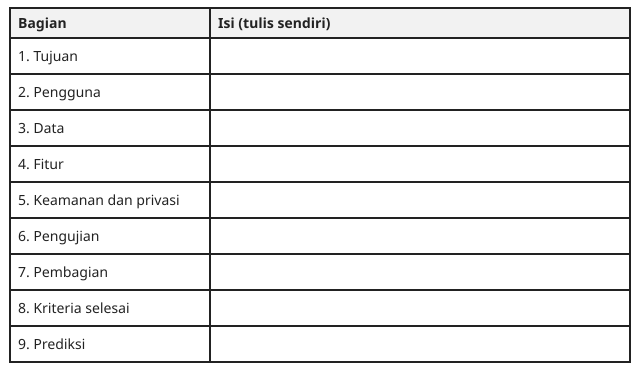

**Ingat dulu:** Dari ingatan, tanpa catatan.

1. Mengapa server berkas statis menyelesaikan jalur lalu memeriksa bahwa hasilnya masih di dalam folder situs? ______
2. Di mana rahasia disimpan agar tidak ikut ke repositori, dan apa yang dilakukan bila terlanjur ter-commit? ______
3. Mengapa berkas unduhan dicatat sidik jari SHA-256-nya? ______



`[Gambar: tabel dua kolom, sembilan baris: Tujuan, Pengguna, Data, Fitur, Keamanan dan privasi, Pengujian, Pembagian, Kriteria selesai, Prediksi. Kolom isi kosong. Kelompokmu mengisinya sebelum mengetik kode.]`

**Prediksi:** Aplikasi "Rekap kantin" (kantin sekolah fiktif) memakai 12 catatan karangan (`minggu` 1 sampai 6, `kategori` minuman dan makanan, `jumlah`) dan tiga uji. Tulis tebakanmu: tiga uji lulus pada percobaan pertama? Ramalan minggu ke-7 berada di antara 90 dan 95? ______

**Lengkapi:** Bagian pemeriksa bentuk satu catatan.

```ts setengah-jadi
typeof o.minggu === "____" &&
typeof o.kategori === "____" &&
typeof o.jumlah === "number" &&
Number.isFinite(o.jumlah) &&
o.jumlah >= ____
```

**Latihan:**

1. `AI: boleh` Tulis rencana satu halaman aplikasi data kelompokmu (data karangan atau terbuka berlisensi yang dicatat) di tabel pada gambar, sebelum kode pertama. Syarat minimal: server lokal, satu rekap, satu ramalan dengan batas yang ditulis, halaman yang memuat data, validasi, tiga uji, README, dan lembar periksa keamanan.
2. `AI: boleh` Tambahkan uji mundur pada `ramal`: tebak minggu ke-6 dari lima minggu pertama dan bandingkan dengan nilai sebenarnya. Selisihnya: ______
3. `AI: boleh` `data.json` hilang saat server dijalankan. Gejalanya, dan cara memberi pesan galat yang jelas di log server tanpa membocorkan jalur berkas ke pengunjung: ______
4. Apa yang dicatat sebuah laporan aplikasi data agar orang lain dapat memeriksa hasilnya? ______
5. Mengapa fungsi pengolah data dipisah dari server dan diuji sendiri? ______

**Cek diri:**

- [ ] Saya dapat merencanakan aplikasi data: pengguna, data, fitur, keamanan, pengujian, tugas.
- [ ] Saya dapat menguji fungsi pengolah dengan `bun test` dan memeriksa tipe dengan `tsc`.
- [ ] Saya dapat menulis laporan dengan sumber, batas ramalan, dan temuan keamanan.

**Catatan cetak (untuk guru, tidak dicetak):** satu sampai dua halaman A4. Kunci ada di modul `b-xi2-m13` bagian "Kunci dan petunjuk". Lembar tidak memuat kolom identitas.
