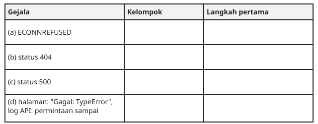

**Ingat dulu:** Dari ingatan, tanpa catatan.

1. Mengapa satu kali pengukuran tidak cukup untuk menyimpulkan satu cara lebih cepat? ______
2. Apa beda rata-rata bergerak dan garis kecenderungan, dan pada data seperti apa rata-rata bergerak tertinggal? ______
3. Apa itu XSS, dan apa dua cara mencegahnya? ______



`[Gambar: tabel berkolom Gejala, Kelompok, Langkah pertama. Empat gejala: (a) ECONNREFUSED, (b) status 404, (c) status 500, (d) halaman menampilkan "Gagal: TypeError" padahal log API menunjukkan permintaan sampai. Dua kolom lainnya kosong.]`

**Latihan:** `AI: tanpa AI`, dalam waktu yang ditetapkan gurumu.

1. Tulis `Bun.serve` di `localhost` dengan rute `GET /api/hitung?a=3&b=4` yang menjawab `{"jumlah":7}`, status 400 bila `a` atau `b` kosong atau bukan angka, dan 404 untuk jalur lain. Jawaban untuk `?a=3&b=x`: ______ Mengapa `Number(null)` perlu dihindari? ______
2. Untuk `[{"k":"a","n":3},{"k":"b","n":"x"},{"k":"a","n":5}]`, tulis rekap per `k` yang menolak `n` bukan angka, beserta banyaknya baris yang ditolak: ______
3. Data `[10, 12, 15, 17, 20]` (minggu 1 sampai 5): kemiringan ______, titik potong ______, ramalan minggu ke-6 dengan garis kecenderungan ______, tebakan rata-rata bergerak lebar 3 ______. Mana yang lebih masuk akal, dan satu hal apa yang tidak diketahui kedua cara? ______
4. Temukan tiga masalah pada kode ini dan tulis perbaikannya:

   ```ts
   const kunci = "KUNCI_PALSU_CONTOH_1";
   const nama = new URL(location.href).searchParams.get("nama") ?? "tamu";
   document.querySelector("#salam")!.innerHTML = "Halo, " + nama;
   console.log("memakai kunci", kunci);
   ```

   Masalah dan perbaikan: ______
5. Isi tabel pada gambar: kelompok (galat jaringan atau respons) dan langkah pertama untuk tiap gejala.

**Cek diri:**

- [ ] Saya dapat membuat API JSON yang memvalidasi masukan dengan status yang tepat.
- [ ] Saya dapat memeriksa, merekap, dan meramal data, dan menyebut batas ramalan.
- [ ] Saya dapat mendiagnosis permintaan gagal dengan status, `curl`, dan DevTools.

**Catatan cetak (untuk guru, tidak dicetak):** satu sampai dua halaman A4. Kunci ada di modul `b-xi2-m14` bagian "Kunci dan petunjuk". Refleksi di modul tidak dikumpulkan dan tidak dimuat. Lembar tidak memuat kolom identitas.
