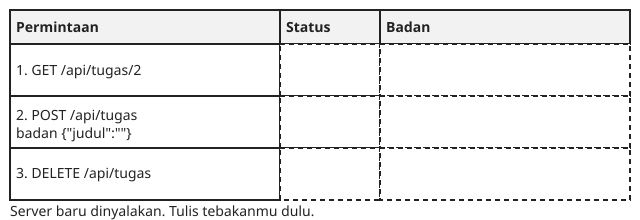

**Ingat dulu:** Dari ingatan, tanpa catatan.

1. Sebutkan bagian-bagian utama sebuah permintaan HTTP dan sebuah balasan HTTP. ______
2. Apa kelebihan `Map` dibanding objek biasa untuk menyimpan pasangan kunci dan nilai? ______



`[Gambar: tabel berkolom Permintaan, Status, Badan dengan tiga baris: GET /api/tugas/2; POST /api/tugas dengan badan {"judul":""}; DELETE /api/tugas. Kolom status dan badan kosong.]`

**Prediksi:** `AI: tanpa AI`. Daftar tugas hidup di memori (isinya karangan). Server baru dinyalakan. Isi tabel pada gambar sebelum menjalankan.

```ts
type Tugas = { id: number; judul: string; selesai: boolean };

const daftar: Tugas[] = [
  { id: 1, judul: "Baca bab contoh", selesai: true },
  { id: 2, judul: "Tulis ringkasan contoh", selesai: false },
];
let idBerikut = 3;

const server = Bun.serve({
  hostname: "localhost",
  port: 3000,
  routes: {
    "/api/tugas": {
      GET: () => Response.json(daftar),
      POST: async (req) => {
        let badan: unknown;
        try {
          badan = await req.json();
        } catch {
          return Response.json({ galat: "badan bukan JSON" }, { status: 400 });
        }
        const judul = (badan as { judul?: unknown }).judul;
        if (typeof judul !== "string" || judul.trim() === "") {
          return Response.json({ galat: "judul wajib berupa teks tidak kosong" }, { status: 400 });
        }
        const baru: Tugas = { id: idBerikut++, judul: judul.trim(), selesai: false };
        daftar.push(baru);
        return Response.json(baru, { status: 201 });
      },
    },
    "/api/tugas/:id": (req) => {
      const id = Number(req.params.id);
      const tugas = daftar.find((t) => t.id === id);
      if (!tugas) return Response.json({ galat: "tugas tidak ditemukan" }, { status: 404 });
      return Response.json(tugas);
    },
  },
  fetch() {
    return Response.json({ galat: "rute tidak ada" }, { status: 404 });
  },
});

console.log(`API jalan di ${server.url}`);
```

**Lengkapi:** Rute yang menghapus tugas: 204 (berhasil, tanpa badan) bila ada, 404 bila tidak ada. Daftar disimpan sebagai `Map` dari id ke tugas.

```ts setengah-jadi
"/api/tugas/:id": {
  DELETE: (req) => {
    const ada = daftar.____(Number(req.params.id));
    return ada
      ? new Response(null, { status: ____ })
      : Response.json({ galat: "tugas tidak ditemukan" }, { status: ____ });
  },
},
```

**Susun:** `AI: tanpa AI`. Susun baris menjadi pengendali `POST` yang menolak JSON rusak dengan 400 dan menerima yang sah.

```text
A.   return Response.json({ galat: "badan bukan JSON" }, { status: 400 });
B. POST: async (req) => {
C.   badan = await req.json();
D. } catch {
E.   let badan: unknown;
F.   try {
G.   return Response.json(badan, { status: 201 });
H. },
I.   }
```

Urutan: ______ , ______ , ______ , ______ , ______ , ______ , ______ , ______ , ______

**Latihan:**

1. `AI: tanpa AI` Tanpa menjalankan, perkirakan status untuk `GET /api/tugas/abc`, `GET /api/tugas/` (garis miring di akhir), dan `GET /api/tugas?x=1`: ______
2. `AI: boleh` Tambahkan `DELETE /api/tugas/:id` (204 bila ada, 404 bila tidak). Uji dengan `curl`, lalu `GET` id yang sama.
3. `AI: boleh` Ubah server agar `DELETE /api/tugas` membalas 405 dengan kepala `Allow: GET, POST`.
4. Apa arti status 201, 400, dan 404 pada API tugas, dan mana yang berarti kesalahan ada pada klien? ______

**Cek diri:**

- [ ] Saya dapat membaca `req.params` dan badan JSON dengan aman.
- [ ] Saya memilih status 200, 201, 400, atau 404 menurut maknanya.
- [ ] Saya dapat menguji API dengan `curl` dan dengan `bun test`.

**Catatan cetak (untuk guru, tidak dicetak):** dua halaman A4. Kunci ada di modul `b-xi2-m2` bagian "Kunci dan petunjuk". Lembar tidak memuat kolom identitas.
