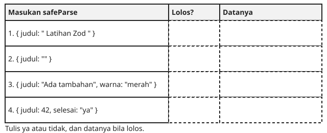

**Ingat dulu:** Dari ingatan, tanpa catatan.

1. Apa arti status 201, 400, dan 404 pada API tugas, dan mana yang berarti kesalahan ada pada klien? ______
2. Apa yang disimpan memoisasi, dan di mana catatannya harus dibuat agar bekerja? ______



`[Gambar: tabel berkolom Masukan safeParse, Lolos?, Datanya dengan empat baris: judul dengan spasi di tepi, judul kosong, judul dengan properti warna tambahan, judul angka 42 dan selesai "ya". Kolom hasil kosong.]`

**Prediksi:** `AI: tanpa AI`. Skema dipakai dengan `TugasBaru.safeParse(masukan)`. Untuk tiap masukan pada gambar, tebak lolos atau tidak, dan datanya bila lolos.

```ts
import { z } from "zod";

export const TugasBaru = z.object({
  judul: z.string().trim().min(1, "judul tidak boleh kosong").max(80, "judul terlalu panjang"),
  selesai: z.boolean().default(false),
});

export type TugasBaru = z.infer<typeof TugasBaru>;
```

**Lengkapi:** Skema untuk `PUT` yang mengganti tugas: `id` bilangan bulat positif, `judul` teks 1 sampai 80 karakter setelah dirapikan, dan `selesai` benar atau salah tanpa nilai bawaan.

```ts setengah-jadi
const Tugas = z.object({
  id: z.number().____().positive(),
  judul: z.string().____().min(1).max(____),
  selesai: z.____(),
});
```

**Susun:** `AI: tanpa AI`. Susun baris menjadi pemakaian `safeParse` pada badan yang sudah dibaca, yang mengembalikan 400 bila salah dan 201 bila benar.

```text
A. const hasil = TugasBaru.safeParse(badan);
B.   return Response.json({ galat: "masukan tidak valid" }, { status: 400 });
C. if (!hasil.success) {
D. }
E. return Response.json(hasil.data, { status: 201 });
```

Urutan: ______ , ______ , ______ , ______ , ______

**Latihan:**

1. `AI: boleh` Tambahkan `prioritas` yang hanya boleh `"rendah"`, `"sedang"`, atau `"tinggi"` dan bernilai bawaan `"sedang"` (`z.enum`). Uji dengan lima masukan, termasuk `"mendesak"`.
2. `AI: tanpa AI` Skema A: `z.string().trim().min(1)`. Skema B: `z.string().min(1).trim()`. Perkirakan hasil keduanya untuk `"   "` (tiga spasi), jalankan, dan jelaskan mengapa berbeda: ______
3. `AI: boleh` Tulis skema untuk `?batas=5&selesai=true` dengan `batas` bilangan bulat 1 sampai 50 (bawaan 10) dan `selesai` boleh tidak ada. Bagaimana kamu mengubah teks menjadi angka dan benar atau salah? ______
4. Apa kode status yang tepat untuk badan yang tidak lolos skema, dan apa yang sebaiknya dimuat di badan balasan? ______

**Cek diri:**

- [ ] Saya dapat menjelaskan mengapa data dari luar perlu diperiksa saat berjalan.
- [ ] Saya memakai `safeParse` dan menjawab 400 berisi rincian per bidang.
- [ ] Saya menurunkan tipe dari skema dengan `z.infer`.

**Catatan cetak (untuk guru, tidak dicetak):** satu sampai dua halaman A4. Kunci ada di modul `b-xi2-m3` bagian "Kunci dan petunjuk". Lembar tidak memuat kolom identitas.
