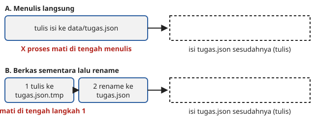

**Ingat dulu:** Dari ingatan, tanpa catatan.

1. Mengapa tipe TypeScript tidak cukup untuk memeriksa badan permintaan, dan apa yang dikerjakan `safeParse`? ______
2. Apa imbalan yang dibayar solusi `Set` untuk mengurangi langkah? ______



`[Gambar: jalur A, tulis langsung ke data/tugas.json, dengan tanda X proses mati di tengah menulis. Jalur B, langkah 1 tulis ke tugas.json.tmp lalu langkah 2 rename ke tugas.json, dengan tanda X mati di tengah langkah 1. Di kanan tiap jalur ada kotak kosong untuk menulis isi tugas.json sesudahnya.]`

**Prediksi:** `AI: tanpa AI`. Berkas `coba.ts` dijalankan pada folder yang belum punya `data/`; `muat` dan `simpan` dari modul. Tebak dulu, tulis, baru jalankan.

```ts
import { muat, simpan } from "./penyimpanan";

const jalur = "data/tugas.json";

console.log("sebelum ada berkas:", JSON.stringify(await muat(jalur)));

await simpan(jalur, [
  { id: 1, judul: "Baca bab contoh", selesai: true },
  { id: 2, judul: "Tulis ringkasan contoh", selesai: false },
]);
console.log("setelah simpan:", JSON.stringify(await muat(jalur)));
console.log(await Bun.file(jalur).text());

await Bun.write(jalur, '[{"id": 1, "judul": "Rusak"');
try {
  await muat(jalur);
} catch (galat) {
  console.log("berkas rusak:", (galat as Error).message);
}

await Bun.write(jalur, '[{"id": "satu", "judul": "", "selesai": false}]');
try {
  await muat(jalur);
} catch (galat) {
  console.log("isi salah:", (galat as Error).message);
}
```

Apa yang tercetak pada baris pertama, dan mengapa tidak ada galat walaupun berkasnya belum ada? ______ Berapa masalah yang dilaporkan pada `isi salah`? ______ Mengapa `simpan` tidak menulis langsung ke `data/tugas.json`? ______

**Lengkapi:** Skrip yang menambah satu catatan setiap dijalankan: baca berkas bila ada, tambahkan, tulis kembali.

```ts setengah-jadi
const berkas = Bun.file("data/catatan.json");
const lama = (await berkas.____()) ? Catatan.parse(JSON.parse(await berkas.____())) : [];

lama.push({ nomor: lama.length + 1, isi: `catatan karangan ke-${lama.length + 1}` });
await Bun.____("data/catatan.json", JSON.stringify(lama, null, 2) + "\n");
```

**Susun:** `AI: tanpa AI`. Susun baris menjadi `muat` yang aman terhadap berkas hilang dan berkas rusak.

```text
A. if (!(await berkas.exists())) return [];
B. export async function muat(jalur: string): Promise<unknown> {
C.   return JSON.parse(await berkas.text());
D.   const berkas = Bun.file(jalur);
E.   throw new Error(`${jalur}: bukan JSON yang sah`);
F. } catch {
G. }
H.   try {
I. }
```

Urutan: ______ , ______ , ______ , ______ , ______ , ______ , ______ , ______ , ______

**Latihan:**

1. `AI: tanpa AI` Jelaskan apa yang terjadi pada `data/tugas.json` bila proses mati tepat saat `simpan` menulis, untuk versi yang menulis langsung dan versi yang memakai berkas sementara (isi kotak gambar): ______
2. `AI: boleh` Rusakkan `data/tugas.json` dengan tangan (hapus tanda kurung di akhir), lalu jalankan server. Apa yang terjadi, dan mengapa lebih baik server berhenti daripada diam-diam memakai daftar kosong? ______
3. `AI: tanpa AI` Server menulis ulang seluruh berkas setiap `POST`. Bila ada 1.000 tugas dan 1.000 `POST` berturut-turut dari daftar kosong, kira-kira berapa total tugas yang tertulis, dan solusi ini linear atau kuadrat? ______
4. Apa yang terjadi pada tugas di memori saat server dimatikan, dan bagaimana tugas itu kembali saat server dinyalakan lagi? ______

**Cek diri:**

- [ ] Saya dapat memuat JSON dengan memeriksa tiga kemungkinan: hilang, bukan JSON, dan bentuk salah.
- [ ] Saya tahu mengapa menulis ke berkas sementara lalu `rename`.
- [ ] Saya tidak memasukkan berkas data berisi data orang ke Git.

**Catatan cetak (untuk guru, tidak dicetak):** dua halaman A4. Kunci ada di modul `b-xi2-m4` bagian "Kunci dan petunjuk". Lembar tidak memuat kolom identitas.
