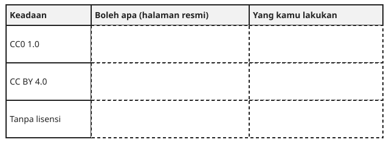

**Ingat dulu:** Dari ingatan, tanpa catatan.

1. Mengapa isi berkas diperiksa dengan skema saat dimuat, padahal program kita sendiri yang menulisnya? ______
2. Mengapa `await req.json()` dibungkus `try/catch`? ______



`[Gambar: tabel berkolom Keadaan, Boleh apa (halaman resmi), Yang kamu lakukan, dengan baris CC0 1.0, CC BY 4.0, Tanpa lisensi. Dua kolom lainnya kosong untuk diisi tanpa melihat modul.]`

**Prediksi:** `AI: tanpa AI`. Berkas `data/penguins.csv` punya 345 baris (satu baris judul) dan 8 kolom. Tiga baris pertamanya:

```text
species,island,bill_length_mm,bill_depth_mm,flipper_length_mm,body_mass_g,sex,year
Adelie,Torgersen,39.1,18.7,181,3750,male,2007
Adelie,Torgersen,NA,NA,NA,NA,NA,2007
```

Potongan program yang menghitung rata-rata massa per spesies:

```ts
for (const b of baris) {
  const massa = Number(b[iMassa]);
  if (b[iMassa] === "NA" || Number.isNaN(massa)) continue;
  const spesies = b[iSpesies]!;
  const sekarang = perSpesies.get(spesies) ?? { n: 0, total: 0 };
  perSpesies.set(spesies, { n: sekarang.n + 1, total: sekarang.total + massa });
}
```

Apa yang terjadi pada rata-rata bila baris `if (...) continue;` dihapus, dan mengapa? ______ Apa yang salah bila sebuah sel berisi koma di dalam tanda kutip, misalnya `"Bandung, Jawa Barat"`? ______

**Lengkapi:** Pemeriksaan bahwa catatan sumber memuat lisensi dan tanggal akses berbentuk `AAAA-BB-HH`.

```ts setengah-jadi
const Catatan = z.object({
  lisensi: z.string().____(1),
  tanggalAkses: z.iso.____(),
  mengandungDataPribadi: z.literal(____),
});
```

**Susun:** `AI: tanpa AI`. Susun baris menjadi pengunduhan yang berhenti dengan pesan jelas bila gagal.

```text
A. const res = await fetch(alamat);
B. await Bun.write("data/berkas.csv", await res.text());
C. if (!res.ok) throw new Error(`unduhan gagal: HTTP ${res.status}`);
D. console.log("tersimpan");
```

Urutan: ______ , ______ , ______ , ______

**Latihan:**

1. `AI: tanpa AI` Isi tabel pada gambar tanpa melihat modul: apa yang boleh dan wajib kamu lakukan untuk tiap keadaan.
2. `AI: tanpa AI` Perkirakan hasil `'1,"Bandung, Jawa Barat",3'.split(",")` dan banyak elemennya, lalu jalankan: ______
3. `AI: boleh` Hitung rata-rata `bill_length_mm` per `island` dari `penguins.csv`, lewati `NA`, dan cetak jumlah pengukuran tiap pulau.
4. Apa tiga pertanyaan yang dijawab sebelum memakai data orang lain, dan mengapa data tanpa lisensi belum boleh dipakai? ______

**Cek diri:**

- [ ] Saya dapat membedakan "tersedia", "boleh dipakai", dan "layak dipercaya".
- [ ] Saya dapat mengunduh dan membaca CSV serta menangani `NA`.
- [ ] Saya mencatat sumber, tanggal akses, dan sidik jari berkas.

**Catatan cetak (untuk guru, tidak dicetak):** satu sampai dua halaman A4. Kunci ada di modul `b-xi2-m5` bagian "Kunci dan petunjuk". Lembar tidak memuat kolom identitas.
