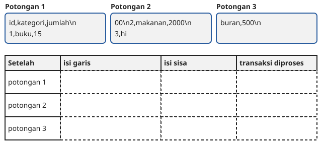

**Ingat dulu:** Dari ingatan, tanpa catatan.

1. Apa tiga pertanyaan yang dijawab sebelum memakai data orang lain, dan mengapa data tanpa lisensi belum boleh dipakai? ______
2. Mengapa `trim()` ditulis sebelum `min(1)` pada skema judul? ______



`[Gambar: tiga kotak potongan teks berurutan, potongan 1 "id,kategori,jumlah\n1,buku,15", potongan 2 "00\n2,makanan,2000\n3,hi", potongan 3 "buran,500\n". Di bawahnya tabel kosong: setelah tiap potongan, isi garis, isi sisa, transaksi diproses.]`

**Prediksi:** `AI: tanpa AI`. `data/transaksi.csv` berisi satu baris judul (`id,kategori,jumlah`) dan 1.000.000 baris transaksi karangan, seluruhnya 21.704.304 bita (sekitar 20,7 MiB). Program `rekap-alir.ts` membacanya sebagai aliran:

```ts
const pembaca = berkas.stream().pipeThrough(new TextDecoderStream());
let sisa = "";
for await (const bagian of pembaca) {
  potongan++;
  const teks = sisa + bagian;
  const garis = teks.split("\n");
  sisa = garis.pop() ?? ""; // baris terakhir mungkin terpotong
  for (const b of garis) proses(b);
}
if (sisa !== "") proses(sisa);
```

1. Bila tiap potongan sekitar 512 KiB, kira-kira berapa potongan yang dibaca? ______
2. Apa yang salah bila baris `sisa = garis.pop() ?? ""` dihapus dan seluruh `garis` diproses? ______

**Lengkapi:** Pembaca baris yang menyambung potongan.

```ts setengah-jadi
let sisa = "";
for await (const bagian of potongan) {
  const garis = (sisa + bagian).split("\n");
  sisa = garis.____() ?? "";
  for (const b of garis) proses(b);
}
if (sisa !== "____") proses(sisa);
```

**Susun:** `AI: tanpa AI`. Susun baris menjadi pembaca berkas yang mengalirkan dan tidak kehilangan baris.

```text
A. let sisa = "";
B. for await (const bagian of berkas.stream().pipeThrough(new TextDecoderStream())) {
C.   const garis = (sisa + bagian).split("\n");
D.   sisa = garis.pop() ?? "";
E.   for (const b of garis) proses(b);
F. }
G. if (sisa !== "") proses(sisa);
```

Urutan: ______ , ______ , ______ , ______ , ______ , ______ , ______

**Latihan:**

1. `AI: tanpa AI` Telusuri batas potongan pada gambar: tuliskan isi `garis` dan `sisa` setelah tiap potongan pada program yang benar, dan transaksi apa yang diproses.
2. `AI: boleh` Perluas rekap agar mencetak rata-rata jumlah per kategori dan banyak transaksi berjumlah sedikitnya 40000, tetap dengan mengalirkan.
3. `AI: tanpa AI` Seorang teman berkata "streaming dua kali lebih cepat" setelah menjalankan sekali. Tulis tiga hal yang kurang dari klaim itu dan cara memperbaiki pengukurannya: ______
4. Apa beda membaca seluruh berkas dengan `text()` dan mengalirkannya, dan apa yang berbeda pada pemakaian memorinya? ______

**Cek diri:**

- [ ] Saya dapat menjelaskan beda membaca seluruh berkas dan mengalirkannya.
- [ ] Saya menangani baris yang terpotong di batas potongan.
- [ ] Saya tahu apa yang tidak dibuktikan oleh satu kali pengukuran.

**Catatan cetak (untuk guru, tidak dicetak):** satu sampai dua halaman A4. Kunci ada di modul `b-xi2-m6` bagian "Kunci dan petunjuk". Lembar tidak memuat kolom identitas.
