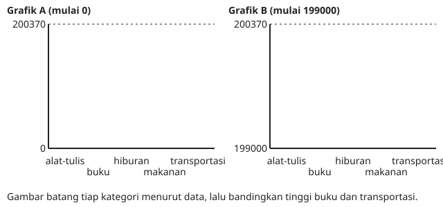

**Ingat dulu:** Dari ingatan, tanpa catatan.

1. Apa beda membaca seluruh berkas dengan `text()` dan mengalirkannya, dan apa yang berbeda pada pemakaian memorinya? ______
2. Sebutkan tiga pemeriksaan yang harus lulus sebelum pustaka diserahkan. ______



`[Gambar: dua bingkai grafik batang berdampingan dengan lima kategori: alat-tulis, buku, hiburan, makanan, transportasi. Grafik A sumbunya mulai dari 0, grafik B mulai dari 199000, keduanya berpuncak di 200370. Batang digambar sendiri.]`

**Prediksi:** `AI: tanpa AI`. Banyak transaksi per kategori dari `data/rekap.json`:

| Kategori | Transaksi |
| --- | --- |
| alat-tulis | 199877 |
| buku | 200370 |
| hiburan | 199813 |
| makanan | 200346 |
| transportasi | 199594 |

Tinggi batang `(nilai - nilaiMulai) / (nilaiMaks - nilaiMulai) × tinggiArea`, dengan `nilaiMaks` = 200370. Gambar batang tiap kategori pada dua bingkai di atas, lalu tulis:

1. Pada grafik A, berapa kali lebih tinggi batang `buku` dibanding `transportasi` (tiga angka di belakang koma)? ______
2. Pada grafik B, berapa kali? ______
3. Grafik mana yang lebih jujur untuk pembaca yang bertanya "apakah kategorinya berbeda jauh?", dan mengapa? ______

**Lengkapi:** Fungsi skala agar batang dengan `nilaiMulai` = 0 setinggi area penuh saat nilainya sama dengan `nilaiMaks`, dan fungsi `esc` untuk tanda lebih kecil.

```ts setengah-jadi
const skala = (v: number): number => ((v - ____) / (nilaiMaks - nilaiMulai)) * ____;

function esc(teks: string): string {
  return teks.replaceAll("&", "&amp;").replaceAll("____", "&lt;");
}
```

**Susun:** `AI: tanpa AI`. Susun baris menjadi pembuatan satu batang SVG dari satu nilai.

```text
A. const h = ((nilai - mulai) / (maks - mulai)) * area;
B. const y = tinggi - bawah - h;
C. return `<rect x="${x}" y="${y}" width="40" height="${h}" fill="#1f5fa8"/>`;
D. function batang(nilai: number, x: number): string {
E. }
```

Urutan: ______ , ______ , ______ , ______ , ______

**Latihan:**

1. `AI: tanpa AI` Bila nama kategori adalah `<b>buku</b> & "alat"` dan `esc` dihapus, apa yang tampil di tabel? Dengan `esc`, apa yang tampil? ______
2. `AI: tanpa AI` Untuk halaman `grafik.html`, tuliskan tiga hal yang membantu pembaca layar atau pembaca yang sulit membedakan warna, dan satu hal yang masih kurang: ______
3. `AI: boleh` Dari `data/penguins.csv` buat grafik batang rata-rata massa per spesies dengan sumbu dari nol, dengan sumber, lisensi, dan tanggal akses di bawah grafik.
4. Mengapa teks dari data dilewatkan `esc` sebelum dimasukkan ke HTML? ______

**Cek diri:**

- [ ] Saya dapat menjelaskan mengapa sumbu batang mulai dari nol.
- [ ] Saya melewatkan teks dari data melalui `esc` sebelum masuk ke HTML.
- [ ] Saya memberi grafik judul, teks pengganti, dan tabel data.

**Catatan cetak (untuk guru, tidak dicetak):** satu sampai dua halaman A4. Kunci ada di modul `b-xi2-m7` bagian "Kunci dan petunjuk". Lembar tidak memuat kolom identitas.
