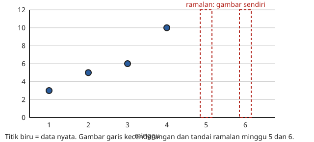

**Ingat dulu:** Dari ingatan, tanpa catatan.

1. Mengapa grafik batang harus memakai sumbu yang mulai dari nol, dan apa yang terjadi bila sumbunya dipotong? ______
2. Apa hasil `Number("")` dan `Number("9o")`, dan bagaimana memeriksa bahwa hasilnya angka yang sah? ______



`[Gambar: sumbu minggu 1 sampai 6 dan nilai 0 sampai 12. Titik data: minggu 1 = 3, minggu 2 = 5, minggu 3 = 6, minggu 4 = 10. Minggu 5 dan 6 ditandai kotak putus-putus kosong untuk ramalan. Gambar garis kecenderungan sendiri.]`

**Prediksi:** `AI: tanpa AI`. Tebak dulu, tulis, baru jalankan.

```ts
function rataBergerak(data: number[], lebar: number): number[] {
  const hasil: number[] = [];
  for (let i = lebar; i <= data.length; i++) {
    const potongan = data.slice(i - lebar, i);
    const jumlah = potongan.reduce((a, b) => a + b, 0);
    hasil.push(jumlah / lebar);
  }
  return hasil;
}

console.log(rataBergerak([10, 20, 30, 40], 2));
console.log(rataBergerak([4, 4, 4, 10], 3));
```

Dua baris yang tercetak: ______  Data pertama naik teratur. Bila rata-rata dua terakhir dipakai untuk menebak nilai berikutnya, apakah tebakannya lebih rendah atau lebih tinggi dari yang kamu harapkan, dan mengapa? ______

**Lengkapi:** Galat rata-rata mutlak: `jumlah |nyata − tebakan| / banyak data`.

```ts setengah-jadi
function galatRataMutlak(nyata: number[], tebakan: number[]): number {
  let total = 0;
  for (let i = 0; i < nyata.length; i++) {
    total += Math.abs((nyata[i] ?? 0) - (tebakan[i] ?? ____));
  }
  return total / ____;
}
console.log(galatRataMutlak([18, 20, 19], [17, 21, 19]));
```

Berapa yang tercetak, dan mengapa tanda selisih dibuang dengan `Math.abs`? ______

**Susun:** Susun baris menjadi fungsi `rataBergerak` yang benar. Satu baris tidak terpakai.

```text
A.   return hasil;
B.   hasil.reverse();
C. function rataBergerak(data: number[], lebar: number): number[] {
D.   for (let i = lebar; i <= data.length; i++) {
E.     const hasil: number[] = [];
F.     hasil.push(potongan.reduce((a, b) => a + b, 0) / lebar);
G.     const potongan = data.slice(i - lebar, i);
H.   }
I. }
J. }
```

Urutan: ______ , ______ , ______ , ______ , ______ , ______ , ______ , ______ , ______ ; tidak terpakai: ______

**Latihan:**

1. `AI: tanpa AI` Hitung dengan tangan garis kecenderungan untuk data pada gambar (minggu 1 sampai 4) dan ramal minggu ke-6. Lalu jalankan versi program dan bandingkan: ______
2. `AI: boleh` Hitung `rataBergerak` untuk `[2, 4, 6, 8, 10]` dengan lebar 2 dan lebar 4. Mana yang tertinggal lebih jauh dari nilai terakhir 10, dan mengapa? ______
3. `AI: boleh` Tulis tiga kalimat tentang batas prediksi pengunjung minggu ke-20 dari sepuluh minggu data: apa yang tidak diketahui program? ______
4. Mengapa prediksi diuji pada data yang tidak dipakai menyusunnya? ______

**Cek diri:**

- [ ] Saya dapat menghitung rata-rata bergerak dan menjelaskan mengapa ia tertinggal pada data menanjak.
- [ ] Saya dapat menghitung galat rata-rata mutlak dan menjelaskan mengapa uji mundur diperlukan.
- [ ] Saya dapat menyebut batas sebuah prediksi dengan jujur.

**Catatan cetak (untuk guru, tidak dicetak):** dua halaman A4. Kunci ada di modul `b-xi2-m8` bagian "Kunci dan petunjuk". Lembar tidak memuat kolom identitas.
