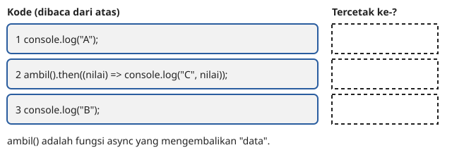

**Ingat dulu:** Dari ingatan, tanpa catatan.

1. Apa beda rata-rata bergerak dan garis kecenderungan, dan pada data seperti apa rata-rata bergerak tertinggal? ______
2. Mengapa balasan "halaman tidak ada" memakai status 404, bukan status 200 dengan teks "tidak ada"? ______



`[Gambar: tiga baris kode: console.log("A"); ambil().then((nilai) => console.log("C", nilai)); console.log("B"). Di kanan tiap baris ada kotak putus-putus kosong untuk menulis urutan tercetaknya.]`

**Prediksi:** `AI: tanpa AI`. Isi kotak pada gambar sebelum menjalankan.

```ts
async function ambil(): Promise<string> {
  return "data";
}

console.log("A");
ambil().then((nilai) => console.log("C", nilai));
console.log("B");
```

Mengapa kode setelah `ambil()` tidak menunggu hasilnya? ______

**Lengkapi:** Fungsi yang menghitung jumlah data dari sebuah alamat.

```ts setengah-jadi
async function jumlahLibur(alamat: string): Promise<number> {
  const respons = await fetch(alamat);
  if (!respons.____) throw new Error(`HTTP ${respons.status}`);
  const badan: unknown = await respons.____();
  return Array.isArray(badan) ? badan.length : 0;
}
```

Apa yang terjadi bila baris `if` dihapus dan alamatnya menghasilkan 404? ______

**Susun:** Susun baris menjadi fungsi yang benar. Satu baris tidak terpakai.

```text
A.   const badan: unknown = await respons.json();
B.   return Array.isArray(badan) ? badan.length : 0;
C. }
D. async function jumlahLibur(alamat: string): Promise<number> {
E.   const respons = await fetch(alamat);
F.   respons.stop();
G.   if (!respons.ok) throw new Error(`HTTP ${respons.status}`);
```

Urutan: ______ , ______ , ______ , ______ , ______ , ______ ; tidak terpakai: ______

**Latihan:**

1. `AI: tanpa AI` Tebak urutan cetak tiga angka, lalu jalankan: `async function a() { console.log(1); await null; console.log(2); }` dipanggil sebagai `a(); console.log(3);`. Urutan: ______
2. `AI: boleh` Tulis `hitungPerBulan(libur)` yang mengembalikan `Map` dari bulan (dua digit, mis. `"05"`) ke jumlah hari libur pada bulan itu, lalu coba pada data tiruan tiga entri.
3. `AI: tanpa AI` Mengapa `await fetch(...)` yang selesai tanpa galat belum berarti permintaan berhasil, dan apa yang harus diperiksa? ______
4. Apa yang kamu periksa sebelum memakai sebuah API publik (kunci atau akun, syarat, batas, kelengkapan)? ______

**Cek diri:**

- [ ] Saya dapat menebak urutan cetak kode yang memakai `async/await`.
- [ ] Saya dapat menulis fungsi pemanggil API dengan pemeriksaan `ok`, bentuk data, dan batas waktu.
- [ ] Saya dapat menjelaskan perbedaan jaringan gagal dan status 404 atau 500.

**Catatan cetak (untuk guru, tidak dicetak):** satu sampai dua halaman A4. Kunci ada di modul `b-xi2-m9` bagian "Kunci dan petunjuk". Lembar tidak memuat kolom identitas.
