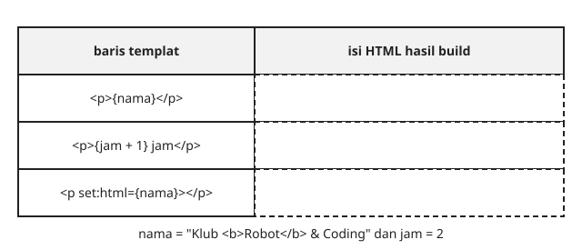

**Ingat dulu:** Tanpa melihat catatan, jawab. (1) Apa itu XSS, dan apa dua cara mencegahnya? ______ (2) Apa yang boleh dan tidak boleh ada di folder yang disajikan ke orang lain? ______



`[Gambar: tabel tiga baris templat Astro: p berisi nama, p berisi jam ditambah satu, dan p dengan set:html nama. Diketahui nama berisi teks Klub dengan b Robot, dan jam bernilai 2. Kolom isi HTML kosong; kamu menuliskan HTML hasil build.]`

**Prediksi:** Tebak dulu, tulis jawabanmu, baru jalankan (`AI: tanpa AI`). Isi tabel pada gambar.

```astro
---
const nama = "Klub <b>Robot</b> & Coding";
const jam = 2;
---
<p>{nama}</p>
<p>{jam + 1} jam</p>
<p set:html={nama}></p>
```

Apakah ada kode JavaScript dari berkas ini yang ikut dikirim ke peramban? ______

**Lengkapi:** Komponen `Tombol.astro` menerima `teks` dan `href`. Isi bagian `____`.

```astro setengah-jadi
---
const { ____, href } = Astro.props;
---
<a class="tombol" href={____}>{teks}</a>
```

Bagaimana kamu memakainya di halaman untuk tombol "Daftar" yang menuju `/daftar/`? ______

**Susun:** Urutkan baris A sampai G menjadi `KartuProgram.astro` yang benar. Satu baris tidak terpakai. `AI: tanpa AI`.

```text
(A) ---
(B) const { judul, ringkas } = Astro.props;
(C) <h3>{judul}</h3>
(D) ---
(E) <article class="kartu">
(F) <p>{ringkas}</p>
(G) </article>
(H) const judul = Astro.props.ringkas;
```

Urutan: ______ ______ ______ ______ ______ ______ ______ Tidak terpakai: ______

**Latihan:**

1. `AI: tanpa AI` Tebak HTML hasil dari `const n = 3;` dengan `<p>{n * 2} jam</p>` dan `<p>{"<i>x</i>"}</p>`, lalu bangun dan cocokkan. ______
2. `AI: tanpa AI` Tulis `console.log("jalan")` di skrip komponen lalu `bun run build`. Muncul di terminal atau di HTML? Mengapa? ______
3. `AI: boleh` Buat skrip komponen melempar galat (`throw new Error("API mati")`). Apa yang dilakukan `bun run build`? ______
4. `AI: boleh` Skrip komponen memanggil `fetch` ke sebuah API. Kapan panggilan itu terjadi, dan apa akibatnya bila API sedang mati saat build? ______

**Cek diri:**

- [ ] Saya dapat menjelaskan skrip komponen dan templat, dan kapan skrip itu berjalan.
- [ ] Saya dapat membuat komponen dengan `props` dan memakainya dari data.
- [ ] Saya dapat menjelaskan mengapa `{...}` aman dan `set:html` berisiko.

**Catatan cetak (untuk guru, tidak dicetak):** dua halaman A4. Kunci ada di modul `b-xii1-m1`, bagian "Kunci dan petunjuk". Lembar tidak memuat kolom identitas.
