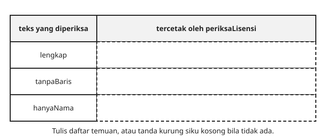

**Ingat dulu:** Tanpa melihat catatan, jawab. (1) Mengapa variabel berawalan `PUBLIC_` pada Astro tidak boleh berisi rahasia? ______ (2) Mengapa `Disallow` di `robots.txt` bukan cara menyembunyikan halaman dari hasil pencarian, dan apa gantinya? ______



`[Gambar: tabel dengan tiga baris teks yang diperiksa, yaitu lengkap, tanpaBaris, dan hanyaNama. Kolom di sebelah kanan kosong; kamu menuliskan apa yang dicetak periksaLisensi untuk tiap teks.]`

**Prediksi:** Tebak dulu, tulis jawabanmu, baru jalankan (`AI: tanpa AI`). Isi tabel pada gambar.

```ts
const SYARAT: [string, RegExp][] = [
  ["judul lisensi", /^MIT License/m],
  ["baris hak cipta", /^Copyright \(c\) \d{4} \S+/m],
  ["kewajiban menyertakan pemberitahuan", /copyright notice and this permission notice shall be included/],
];

function periksaLisensi(teks: string): string[] {
  return SYARAT.filter(([, pola]) => !pola.test(teks)).map(([nama]) => `kurang: ${nama}`);
}

const lengkap = [
  "MIT License",
  "",
  "Copyright (c) 2026 Pemegang-Contoh",
  "",
  "Permission is hereby granted, free of charge, ... (izin dipersingkat)",
  "",
  "The above copyright notice and this permission notice shall be included in all",
  "copies or substantial portions of the Software.",
].join("\n");

const tanpaBaris = lengkap.replace("Copyright (c) 2026 Pemegang-Contoh\n", "");
const hanyaNama = "Proyek ini berlisensi MIT.";

console.log(periksaLisensi(lengkap));
console.log(periksaLisensi(tanpaBaris));
console.log(periksaLisensi(hanyaNama));
```

Mengapa menulis "berlisensi MIT" saja tidak cukup menurut pemeriksa ini? ______

**Lengkapi:** Pemeriksa jalur berkas dalam backtick pada README. Isi bagian `____`.

```ts setengah-jadi
function jalurTakAda(teks: string, ada: string[]): string[] {
  const hasil: string[] = [];
  for (const m of teks.matchAll(/`([^`\s]+\/[^`\s]+)`/g)) {
    const jalur = m[1] ?? "";
    if (!ada.____(jalur)) hasil.push(jalur);
  }
  return hasil;
}
```

**Susun:** Urutkan baris A sampai F menjadi langkah memperbarui README sampai gerbang dokumen lolos. Satu baris tidak terpakai. `AI: tanpa AI`.

```text
(A) bun run audit:dokumen
(B) Ubah penanda i18n-source-hash dengan tangan
(C) bun run docs:i18n:stamp
(D) Ubah README.id.md mengikuti perubahan
(E) Ubah README.md
(F) bun run audit:translation
```

Urutan: ______ ______ ______ ______ ______ Tidak terpakai: ______

**Latihan:**

1. `AI: tanpa AI` Seorang teman menghapus berkas `LICENSE` dari repositori turunan "karena ini proyek kami". Berdasarkan teks MIT, apa yang keliru, dan apa yang kamu sarankan? ______
2. `AI: boleh` Tulis bagian atribusi untuk sebuah foto fiktif berlisensi CC BY 4.0: judul, pencipta (karangan), tautan lisensi, dan pernyataan perubahan. ______
3. `AI: tanpa AI` Dua keluaran: `audit:translation FAILED ... README.id.md: stale mirror` dan `audit:dokumen FAILED ... [dead-link] docs/panduan.md`. Untuk tiap keluaran, tulis penyebab dan perbaikannya. ______
4. `AI: boleh` README menyebut `SITE_URL`. Mengapa dokumen sebaiknya menyatakan bahwa nilainya harus alamat `https` lengkap? ______

**Cek diri:**

- [ ] Saya dapat menulis README dengan perintah dan jalur yang benar-benar ada.
- [ ] Saya dapat memperbarui cermin terjemahan dan lolos `audit:translation`.
- [ ] Saya dapat menjelaskan satu syarat utama MIT dan mengapa `LICENSE` dijaga.

**Catatan cetak (untuk guru, tidak dicetak):** dua halaman A4. Kunci ada di modul `b-xii1-m11`, bagian "Kunci dan petunjuk". Bagian lisensi bukan nasihat hukum; pertanyaan lisensi yang rumit dibawa ke guru. Lembar tidak memuat kolom identitas.
