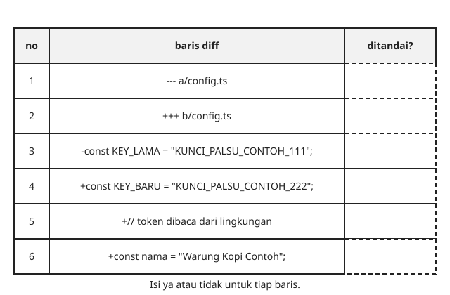

**Ingat dulu:** Tanpa melihat catatan, jawab. (1) Mengapa `README.id.md` dinyatakan basi setelah `README.md` diubah, dan apa dua langkah memperbaikinya? ______ (2) Apa beda uji unit pada sebuah fungsi dengan uji atas hasil build? ______



`[Gambar: tabel enam baris diff bernomor 1 sampai 6. Dua baris pertama kepala berkas, baris 3 menghapus KEY_LAMA, baris 4 menambah KEY_BARU, baris 5 menambah komentar tentang token, baris 6 menambah nama. Kolom ditandai kosong; kamu mengisi ya atau tidak.]`

**Prediksi:** Tebak dulu, tulis jawabanmu, baru jalankan (`AI: tanpa AI`). Isi kolom ditandai pada gambar.

```ts
const PENANDA = /\b[A-Z0-9_]*(?:KUNCI|KEY|TOKEN|SECRET|SANDI|PASSWORD)[A-Z0-9_]*\s*[=:]\s*["']?([^\s"']+)/i;

function pindaiTambahan(diff: string): string[] {
  const temuan: string[] = [];
  diff.split("\n").forEach((baris, i) => {
    if (baris.startsWith("+") && !baris.startsWith("+++") && PENANDA.test(baris)) {
      temuan.push(`baris diff ${i + 1}: kemungkinan rahasia ditambahkan`);
    }
  });
  return temuan;
}

const diff = [
  "--- a/config.ts",
  "+++ b/config.ts",
  '-const KEY_LAMA = "KUNCI_PALSU_CONTOH_111";',
  '+const KEY_BARU = "KUNCI_PALSU_CONTOH_222";',
  "+// token dibaca dari lingkungan",
  '+const nama = "Warung Kopi Contoh";',
].join("\n");

console.log(pindaiTambahan(diff));
```

Baris yang dihapus (`-`) memuat nilai mirip rahasia. Apakah itu juga layak menjadi temuan, dan mengapa? ______

**Lengkapi:** Pemeriksa kontras teks biasa (batas minimal 4,5:1). Isi bagian `____` dengan operator pembanding.

```ts setengah-jadi
function lolosTeksBiasa(rasio: number): boolean {
  return rasio ____ 4.5;
}
```

**Susun:** Urutkan baris A sampai E menjadi fungsi penilai baris diff. Satu baris tidak terpakai. `AI: tanpa AI`.

```text
(A) }
(B)   return tambahan && PENANDA.test(baris);
(C) function adalahTambahanRahasia(baris: string): boolean {
(D)   return PENANDA.test(baris);
(E)   const tambahan = baris.startsWith("+") && !baris.startsWith("+++");
```

Urutan: ______ ______ ______ ______ Tidak terpakai: ______

**Latihan:**

1. `AI: boleh` Tulis ulang komentar "Kamu ceroboh, token kok ditaruh di kode" menjadi komentar yang ditujukan ke kode dan berisi temuan, alasan, dan saran. ______
2. `AI: tanpa AI` Sebuah perubahan buatan AI menambahkan paket `pemeriksa-kontras-super` ke `package.json` dan menyalin 200 baris kode. Apa tiga hal yang kamu periksa sebelum menyetujuinya? ______
3. `AI: boleh` Peninjau menemukan README Inggris diubah, cermin Indonesia belum. Tulis komentar ulasannya dan langkah perbaikan. ______
4. `AI: boleh` Cabang teman lolos semua gerbang. Apa yang tetap harus dinilai manusia, dan mengapa? ______

**Cek diri:**

- [ ] Saya dapat meninjau kustomisasi teman dengan daftar periksa.
- [ ] Saya dapat menulis komentar berisi temuan, alasan, dan saran.
- [ ] Saya dapat meninjau kode buatan AI seperti kode sejawat.

**Catatan cetak (untuk guru, tidak dicetak):** dua halaman A4. Kunci ada di modul `b-xii1-m12`, bagian "Kunci dan petunjuk". Lembar tidak memuat kolom identitas.
