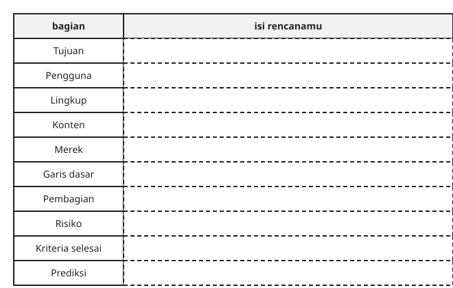

**Ingat dulu:** Tanpa melihat catatan, jawab. (1) Sebutkan enam hal yang diperiksa saat meninjau kustomisasi teman. ______ (2) Rahasia terlanjur ter-commit: sebutkan langkah yang benar berurutan. ______ (3) Apa fungsi `--dry-run`, dan kapan `--yes` diperlukan pada `template:init`? ______

`[Gambar: tabel dua kolom, bagian dan isi rencanamu. Sepuluh bagiannya: Tujuan, Pengguna, Lingkup, Konten, Merek, Garis dasar, Pembagian, Risiko, Kriteria selesai, dan Prediksi. Kolom isi kosong untuk kamu isi sebelum mengubah apa pun.]`

**Lengkapi:** Tulis rencana satu halaman untuk kustomisasi kelompokmu pada tabel di gambar. Sebut juga apa yang tidak dikerjakan (backend tidak disentuh), dan tulis tebakanmu pada bagian Prediksi. Semua nama, kontak, dan konten karangan. ______

**Latihan:**

1. Periksa daftar tugas berikut. Aturannya: tiap tugas punya kriteria selesai, paling lama 4 jam, dan beban satu orang tidak melebihi 8 jam. Temuan apa yang kamu dapat, dan bagaimana memperbaikinya? ______

   | Tugas | Pemilik | Jam | Selesai bila |
   | --- | --- | --- | --- |
   | Tulis judul dan deskripsi tiap halaman | Ani | 2 | audit SEO bersih |
   | Ganti warna dan periksa kontras | Beni | 3 | rasio teks minimal 4,5:1 |
   | Perbarui README dan cermin | Cici | 2 | |
   | Susun seluruh konten halaman Layanan | Ani | 6 | teks bersumber dan dibaca teman |
   | Pindai rahasia pada diff | Ani | 1 | pindai bersih |

2. `AI: boleh` Dari gerbang yang kamu catat, tentukan mana yang dijalankan setelah tiap tugas dan mana hanya di akhir sprint, beserta alasannya. ______
3. `AI: boleh` Untuk tiap tugas di rencanamu, tulis dokumen apa yang ikut diperbarui, dan siapa yang memeriksa cerminnya. ______
4. Tukar rencana dengan kelompok lain. Tulis ulasan: satu yang sudah baik, satu yang perlu diperbaiki, satu langkah berikutnya. ______

**Cek diri:**

- [ ] Saya dapat memecah pekerjaan menjadi tugas dengan pemilik, jam, dan kriteria selesai.
- [ ] Saya dapat mencatat garis dasar gerbang sebelum mulai.
- [ ] Saya dapat menulis rencana satu halaman yang dapat dinilai teman.

**Catatan cetak (untuk guru, tidak dicetak):** dua halaman A4. Modul ini tidak punya bagian "Kunci dan petunjuk"; rencana contoh ada pada bagian "Rencana sprint" modul `b-xii1-m13`. Dikerjakan berkelompok dua sampai tiga orang. Lembar tidak memuat kolom identitas.
