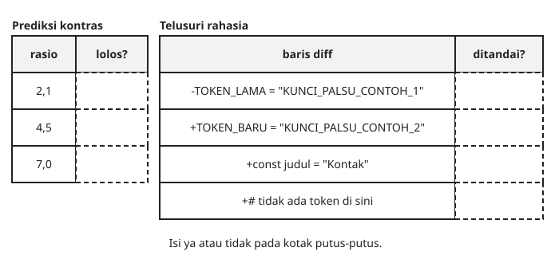

**Ingat dulu:** Tanpa melihat catatan, jawab. (1) Satu kalimat apa yang diwajibkan lisensi MIT, dan mengapa `LICENSE` tidak dihapus dari repositori turunan? ______ (2) Apa yang dibuktikan dan tidak dibuktikan oleh gerbang yang hijau? ______ (3) Sebutkan empat hal yang membuat sebuah tugas dalam rencana dapat diperiksa orang lain. ______

`[Gambar: dua tabel. Tabel Prediksi kontras punya tiga rasio 2,1; 4,5; dan 7,0 dengan kolom lolos kosong. Tabel Telusuri rahasia punya empat baris diff dengan kolom ditandai kosong; kamu mengisinya dengan ya atau tidak.]`

**Prediksi:** (Kontras) Tiga pasangan warna teks dan latar memberi rasio pada tabel di gambar. Dengan batas 4,5:1 untuk teks biasa, isi kolom lolos. Apa yang kamu ubah pada yang gagal? ______ `AI: tanpa AI`.

**Latihan:** Kerjakan sendiri, `AI: tanpa AI`, dalam waktu yang ditetapkan gurumu.

1. **Telusuri (rahasia).** Pemindai menandai baris tambahan (`+`) berpola `NAMA = "nilai"` dengan NAMA memuat `KUNCI`, `KEY`, `TOKEN`, `SECRET`, `SANDI`, atau `PASSWORD`. Isi kolom ditandai pada tabel kedua di gambar. Apa yang tetap harus dilakukan atas baris `-`? ______
2. **Ulas (dokumen dan lisensi).** README berisi: "Proyek ini berlisensi MIT. Baca `docs/ada.md` dan `docs/hilang.md`. Jalankan `bun run situs`." Berkas yang ada: `README.md`, `docs/ada.md`, `package.json` (skrip: `periksa-tipe`, `uji`, `bangun`). Temukan tiga masalah dan tulis satu komentar ulasan (temuan, alasan, saran). ______
3. **Diagnosis (gerbang).** `bun run gerbang` menjalankan `periksa-tipe`, `uji`, `bangun`, `uji-bangun`. Keluarannya berakhir dengan `error: script "uji-bangun" exited with code 1` dan uji "tidak ada dua halaman berdeskripsi sama" gagal. Langkah mana yang berjalan, apa penyebabnya, dan apa yang diperbaiki? ______
4. **Tulis (SEO).** Tulis fungsi `cariJudulKembar(halaman)` untuk daftar `{ jalur, judul }` yang mengembalikan judul yang dipakai lebih dari satu halaman. Sebutkan hasilnya untuk empat halaman berjudul `Warung Kopi Contoh`, `Layanan`, `Layanan`, dan `Tentang kami`. ______
5. **Template.** Jelaskan dalam lima sampai delapan kalimat jalan dari "Use this template" sampai situs `landing` bermerek, apa yang boleh kamu ubah, dan satu hal yang tidak boleh kamu sentuh beserta alasannya. ______

**Cek diri:**

- [ ] Saya dapat mengenali rahasia pada diff dan permintaan ke asisten AI.
- [ ] Saya dapat membaca keluaran gerbang dan menemukan penyebab kegagalan.
- [ ] Saya dapat meninjau dokumen dan lisensi serta menulis rencana tugas yang dapat diperiksa.

**Catatan cetak (untuk guru, tidak dicetak):** dua halaman A4, dikerjakan mandiri sesuai waktu yang ditetapkan guru. Kunci ada di modul `b-xii1-m14`, bagian "Kunci dan petunjuk". Soal praktik dan refleksi pada modul tidak dimuat. Lembar tidak memuat kolom identitas.
