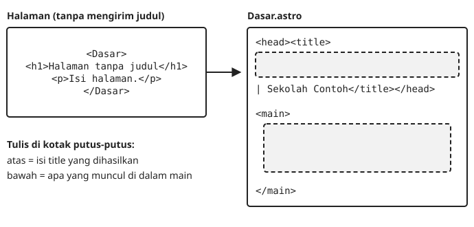

**Ingat dulu:** Tanpa melihat catatan, jawab. (1) Apa isi bagian di antara dua garis `---` pada berkas `.astro`, dan kapan kode itu dijalankan? ______ (2) Mengapa fungsi pengolah data dipisah dari server dan diuji sendiri? ______



`[Gambar: di kiri sebuah halaman yang memakai tata letak Dasar dengan h1 "Halaman tanpa judul" dan p "Isi halaman." tanpa mengirim judul. Di kanan berkas Dasar.astro dengan head, title, dan main. Dua kotak putus-putus kosong: satu untuk isi title yang dihasilkan, satu untuk apa yang muncul di dalam main.]`

**Prediksi:** Tebak dulu, tulis jawabanmu, baru jalankan (`AI: tanpa AI`). Berkas ini adalah tata letak `Dasar.astro`. Sebuah halaman memakainya begini: `<Dasar><h1>Halaman tanpa judul</h1><p>Isi halaman.</p></Dasar>`, tanpa mengirim `judul`.

```astro
---
const { judul = "Tanpa judul" } = Astro.props;
---
<head><title>{judul} | Sekolah Contoh</title></head>
<main>
  <slot />
</main>
```

Isi dua kotak kosong pada gambar. Apa isi `<title>` yang dihasilkan? ______ Di mana `<h1>` dan `<p>` itu muncul di HTML hasil? ______

**Lengkapi:** Buat halaman dari `daftarInfo`. Isi bagian `____`.

```ts setengah-jadi
export function getStaticPaths() {
  return daftarInfo.____((info) => ({ params: { ____: info.slug }, props: { info } }));
}
```

Mengapa nama kunci di `params` harus sama dengan nama di dalam kurung siku pada nama berkas? ______

**Susun:** Urutkan baris A sampai I menjadi tata letak `Dasar.astro` yang benar. Satu baris tidak terpakai. `AI: tanpa AI`.

```text
(A) ---
(B) const { judul = "Tanpa judul" } = Astro.props;
(C) ---
(D) <html lang="id">
(E) <head><title>{judul}</title></head>
(F) <body>
(G) <slot />
(H) </body>
(I) </html>
(J) <slot judul />
```

Urutan: ______ ______ ______ ______ ______ ______ ______ ______ ______ Tidak terpakai: ______

**Latihan:**

1. `AI: tanpa AI` Tebak `<title>` halaman `/info/klub-robot/` pada situs contoh, lalu bangun dan cocokkan. ______
2. `AI: tanpa AI` Mengapa tautan menu di tata letak ditulis sekali, dan apa yang rusak bila kamu mengganti nama berkas `kontak.astro` menjadi `hubungi.astro` tanpa mengubah tata letak? ______
3. `AI: boleh` Di mana skrip tata letak berjalan, dan lewat apa halaman mengirim `judul` ke tata letak? ______
4. `AI: boleh` Data klub dipakai tiga halaman, dan skrip `periksa-data.ts` memeriksanya sendiri. Apa manfaat pemisahan itu ketika data bertambah menjadi dua puluh entri? ______

**Cek diri:**

- [ ] Saya dapat membuat tata letak dengan `<slot />` dan prop bernilai bawaan.
- [ ] Saya dapat membuat halaman dari data dengan `getStaticPaths`.
- [ ] Saya dapat memeriksa bentuk data dengan skrip sebelum build.

**Catatan cetak (untuk guru, tidak dicetak):** dua halaman A4. Kunci ada di modul `b-xii1-m2`, bagian "Kunci dan petunjuk". Lembar tidak memuat kolom identitas.
