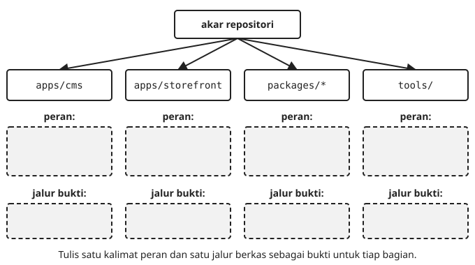

**Ingat dulu:** Tanpa melihat catatan, jawab. (1) Apa fungsi `<slot />` dalam tata letak, dan bagaimana tata letak memberi nilai bawaan untuk prop yang tidak dikirim? ______ (2) Apa yang kamu periksa sebelum memakai sebuah API publik? ______



`[Gambar: akar repositori di atas dengan empat kotak di bawahnya: apps/cms, apps/storefront, packages/*, dan tools/. Di bawah tiap kotak ada dua kotak putus-putus kosong, satu untuk peran dan satu untuk jalur berkas sebagai bukti.]`

**Prediksi:** Tebak dulu, tulis jawabanmu, baru cek di repositori (`AI: tanpa AI`). Pada akar repositori, `package.json` memuat `"build": "cd apps/storefront && bun run build"`. Pada `apps/storefront/package.json` tertulis `"build": "bun run check && bun --bun astro build && bun run build:build-id && bun run build:penyaji"` dan `"check": "bun --bun astro check"`. Bila kamu menjalankan `bun run build` di akar, perintah apa yang berjalan pertama kali di dalam `apps/storefront`? ______ Bagian mana yang tidak ikut terbangun: `apps/cms` atau `apps/storefront`? ______

**Lengkapi:** Penyaring berkas ADR. Isi bagian `____`.

```ts setengah-jadi
const adr = readdirSync(join(akar, "docs", "adr")).filter(
  (f) => /^\d{4}-.*\.md$/.test(f) && !f.____(".id.md"),
);
```

Mengapa berkas yang berakhiran `.id.md` dibuang, dan apa yang terjadi pada hitungan bila tidak dibuang? ______

**Susun:** Urutkan baris A sampai C menjadi pembaca `package.json` yang mencetak nama paket. Satu baris tidak terpakai. `AI: tanpa AI`.

```text
(A) import { readFileSync } from "node:fs";
(B) const paket = JSON.parse(readFileSync("awcms-one/package.json", "utf8"));
(C) console.log("nama:", paket.name);
(D) const paket = readFileSync("awcms-one/package.json");
```

Urutan: ______ ______ ______ Tidak terpakai: ______

**Latihan:**

1. `AI: tanpa AI` Baca bagian "Template-only runtime rule" pada README dan tulis dengan kata-katamu sendiri dalam dua kalimat apa artinya bagi turunan template. ______
2. `AI: boleh` Isi peta pada gambar: tiap bagian satu kalimat dengan jalur berkas sebagai bukti.
3. `AI: tanpa AI` README menyebut `bun test` di akar tidak menjalankan uji `apps/cms`. Apa dua alasannya menurut README? ______
4. `AI: boleh` Mengapa salinan dangkal (`--depth 1`) cukup untuk membaca tetapi tidak cukup untuk meninjau riwayat perubahan sebuah berkas? ______

**Cek diri:**

- [ ] Saya dapat membedakan `apps/storefront` dan `apps/cms`.
- [ ] Saya dapat menjelaskan aturan template-only dengan kata sendiri.
- [ ] Saya dapat menelusuri sebuah pertanyaan dengan `grep` dan membuktikannya dengan jalur berkas.

**Catatan cetak (untuk guru, tidak dicetak):** dua halaman A4. Kunci ada di modul `b-xii1-m3`, bagian "Kunci dan petunjuk". Lembar tidak memuat kolom identitas.
