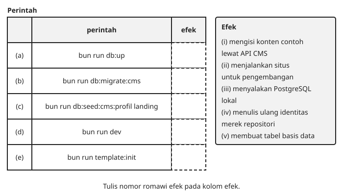

**Ingat dulu:** Tanpa melihat catatan, jawab. (1) Apa beda `apps/storefront` dan `apps/cms`, dan mana yang berisi basis data? ______ (2) Mengapa `{nama}` di templat Astro aman bila `nama` berisi tanda `<`, dan kapan `set:html` berbahaya? ______



`[Gambar: di kiri tabel lima perintah (a) sampai (e) dengan kolom efek kosong. Di kanan daftar lima efek bernomor (i) sampai (v). Kamu menulis nomor efek yang cocok pada kolom efek.]`

**Prediksi:** Tebak dulu, tulis jawabanmu, sebelum guru menjalankannya (`AI: tanpa AI`). Dua perintah dijalankan guru di folder `apps/storefront` sebuah repositori turunan, satu per satu (`PORT` diganti port sumber konten milik guru). Tiga profil yang dikenal storefront adalah `toko`, `berita`, dan `landing`.

```sh
env -u AWCMS_API_URL SITE_PROFILE=landing bun --bun astro build
env AWCMS_API_URL=http://localhost:PORT SITE_PROFILE=blog bun --bun astro build
```

Apakah perintah pertama berhasil? Bila gagal, apa sebabnya? ______ Apakah perintah kedua berhasil? Bila gagal, apa pesan yang kamu harapkan? ______

**Lengkapi:** Pengelompok perintah Docker. Isi bagian `____`.

```ts setengah-jadi
function golongan(perintah: string): string {
  if (perintah.includes("____")) return "docker";
  return "lain";
}
```

Skrip mana pada daftar guru yang akan salah digolongkan oleh fungsi yang hanya mencari `docker`? ______

**Susun:** Urutkan baris A sampai F menjadi fungsi `golongan` yang benar. Satu baris tidak terpakai. `AI: tanpa AI`.

```text
(A) function golongan(perintah: string): string {
(B)   if (perintah.includes("docker compose")) return "docker";
(C)   if (perintah.includes("apps/cms")) return "cms";
(D)   return "lain";
(E) }
(F)   return perintah.length;
```

Urutan: ______ ______ ______ ______ ______ Tidak terpakai: ______

**Latihan:**

1. `AI: tanpa AI` Cocokkan perintah dengan efeknya pada tabel di gambar.
2. `AI: tanpa AI` Apa yang dipakai bila `SITE_PROFILE` dikosongkan, dan mengapa gagal lebih baik daripada diam-diam memakai bawaan untuk nilai yang salah? ______
3. `AI: boleh` Tulis dulu rancangan catatan demonstrasi: tiga kolom (perintah, prediksimu, yang terjadi). Isi kolom prediksi sebelum guru menjalankan tiap langkah.
4. `AI: tanpa AI` Sebutkan tiga hal yang tidak boleh ada di repositori turunan terkait berkas `.env`, dan satu hal yang dilakukan bila terlanjur. ______

**Cek diri:**

- [ ] Saya dapat menjelaskan bahwa storefront mengambil konten dari CMS saat build.
- [ ] Saya dapat menjelaskan `SITE_PROFILE` dan akibat nilai yang salah.
- [ ] Saya dapat mencocokkan perintah dengan efeknya dan menyebut mana yang butuh Docker.

**Catatan cetak (untuk guru, tidak dicetak):** dua halaman A4. Kunci ada di modul `b-xii1-m4`, bagian "Kunci dan petunjuk". Langkah demonstrasi dijalankan guru; murid tidak menyentuh backend. Lembar tidak memuat kolom identitas.
