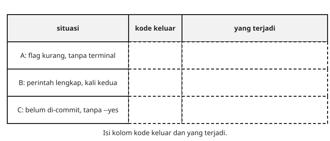

**Ingat dulu:** Tanpa melihat catatan, jawab. (1) Mengapa `bun run build` pada storefront gagal bila `AWCMS_API_URL` tidak diisi? ______ (2) Mengapa halaman dinamis `[slug].astro` pada situs statis wajib punya `getStaticPaths`? ______



`[Gambar: tabel tiga baris situasi: A flag kurang tanpa terminal, B perintah lengkap kali kedua, C ada berkas belum di-commit tanpa --yes. Kolom kode keluar dan kolom yang terjadi kosong untuk diisi.]`

**Prediksi:** Tebak dulu, tulis jawabanmu, baru jalankan (`AI: tanpa AI`). `template:init` punya flag wajib: `--nama`, `--slug`, `--domain`, `--profil`, `--warna-primer`, `--kontak-email`. Tiga situasi, semuanya di repositori turunan yang bersih kecuali disebut lain:

- A: `bun run template:init --nama "Sekolah Contoh"` tanpa terminal interaktif (`< /dev/null`).
- B: perintah lengkap yang sama dijalankan dua kali berturut-turut, tanpa mengubah flag.
- C: perintah lengkap dijalankan ketika ada berkas yang diubah dan belum di-commit, tanpa `--yes`.

Isi tabel pada gambar. Mengapa alat meminta pohon kerja bersih lebih dulu? ______

**Lengkapi:** Penafsir kode keluar. Isi dua `____` dengan kode yang sesuai.

```ts setengah-jadi
function tafsir(kode: number): string {
  switch (kode) {
    case 0:
      return "berhasil atau tidak ada yang perlu dikerjakan";
    case ____:
      return "flag wajib kurang pada mode tanpa terminal";
    case ____:
      return "ditolak: pohon kerja belum bersih";
    default:
      return "lihat dokumentasi";
  }
}
```

Mengapa `default` ada di akhir? ______

**Susun:** Urutkan baris A sampai G menjadi langkah membuat repositori turunan lokal. Satu baris tidak terpakai. `AI: tanpa AI`.

```text
(A) git clone --depth 1 https://github.com/ahliweb/awcms-one.git sekolah-contoh
(B) cd sekolah-contoh
(C) rm -rf .git
(D) git init -b main
(E) git add -A
(F) git commit -m "awal dari template"
(G) git push --force origin main
```

Urutan: ______ ______ ______ ______ ______ ______ Tidak terpakai: ______

**Latihan:**

1. `AI: tanpa AI` Kamu menjalankan `template:init` dengan `--warna-primer biru`. Tebak kode keluar dan pesannya, lalu coba dengan `--dry-run`. ______
2. `AI: tanpa AI` Mengapa guru meminta kamu men-commit pekerjaanmu sebelum menjalankan `template:init`, dan apa keuntungannya bagi kamu sesudahnya? ______
3. `AI: boleh` Daftar `Remove:` memuat folder contoh konten penerapan referensi. Apa isi folder itu menurut bacaanmu, dan mengapa turunan tidak membutuhkannya? ______
4. `AI: boleh` Seorang teman mengisi `--kontak-email` dengan surel pribadinya lalu mengunggah repositori ke tempat publik. Apa risikonya dan apa gantinya untuk latihan? ______

**Cek diri:**

- [ ] Saya dapat membuat repositori turunan lokal tanpa riwayat.
- [ ] Saya dapat menjalankan `template:init --dry-run` dan membaca daftarnya.
- [ ] Saya dapat menafsirkan kode keluar 0, 2, dan 3.

**Catatan cetak (untuk guru, tidak dicetak):** dua halaman A4. Kunci ada di modul `b-xii1-m5`, bagian "Kunci dan petunjuk". Lembar tidak memuat kolom identitas.
