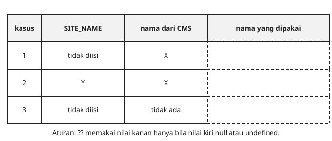

**Ingat dulu:** Tanpa melihat catatan, jawab. (1) Mengapa `template:init` aman dijalankan dua kali dengan flag yang sama? ______ (2) Mengapa turunan template tidak boleh memakai backend produksi `awcms-one`? ______



`[Gambar: tabel tiga kasus dengan kolom SITE_NAME, nama dari CMS, dan nama yang dipakai. Kasus 1: tidak diisi dan X. Kasus 2: Y dan X. Kasus 3: tidak diisi dan tidak ada. Kolom nama yang dipakai kosong untuk diisi.]`

**Prediksi:** Tebak dulu, tulis jawabanmu, baru cek (`AI: tanpa AI`). Di `apps/storefront/src/lib/awcms/profil.ts` ada baris yang memilih nama situs. `payload.siteName` adalah nama dari CMS; `DEFAULT_IDENTITY.name` ditulis `template:init`. Operator `??` memakai nilai kanan hanya bila nilai kiri `null` atau `undefined`.

Barisnya: `name: readEnv("SITE_NAME") ?? payload.siteName ?? DEFAULT_IDENTITY.name,`

Isi kolom terakhir tabel pada gambar untuk ketiga kasus.

**Lengkapi:** Fungsi pemilih nama. Isi dua `____` dengan operator yang sama dengan baris di atas.

```ts setengah-jadi
function pilihNama(env: string | undefined, cms: string | undefined, bawaan: string): string {
  return env ____ cms ____ bawaan;
}
```

Apa bedanya bila ditulis dengan `||` dan `env` berisi teks kosong `""`? ______

**Susun:** Urutkan baris A sampai D menjadi langkah mengubah warna merek. Satu baris tidak terpakai. `AI: tanpa AI`.

```text
(A) bun run template:init ... --warna-primer "#b91c1c" --dry-run
(B) bun run template:init ... --warna-primer "#b91c1c"
(C) git diff apps/storefront/src/config/site.ts
(D) git commit -am "ganti warna primer"
(E) bun run template:init ... --nama "Nama Asli Orang Lain"
```

Urutan: ______ ______ ______ ______ Tidak terpakai: ______

**Latihan:**

1. `AI: tanpa AI` Berapa temuan yang dicetak `periksa-konten.ts` pada berkas contoh asli, dan apa saja? Jalankan untuk mencocokkan. ______
2. `AI: tanpa AI` Mengapa halaman kebijakan privasi tidak boleh sekadar menulis "situs ini tidak mengumpulkan data" bila kelak ada formulir kontak? ______
3. `AI: boleh` Di jalur mana pada repositori turunan konten contoh profil `landing` tersimpan, dan siapa yang memasukkannya ke CMS di kelas ini? ______
4. `AI: boleh` Hasil build disajikan di jaringan lab. Token build `AWCMS_API_TOKEN` hanya dipakai saat build dan tidak diberi awalan `PUBLIC_`. Mengapa itu penting bagi isi `dist/`? ______

**Cek diri:**

- [ ] Saya dapat menyebut tiga lapisan merek dan urutan prioritasnya.
- [ ] Saya dapat mengganti warna, nama, kontak, dan konten dengan nilai fiktif.
- [ ] Saya dapat memeriksa konten dengan skrip dan `--dry-run`, dan menyatakan batasnya.

**Catatan cetak (untuk guru, tidak dicetak):** dua halaman A4. Kunci ada di modul `b-xii1-m6`, bagian "Kunci dan petunjuk". Lembar tidak memuat kolom identitas.
