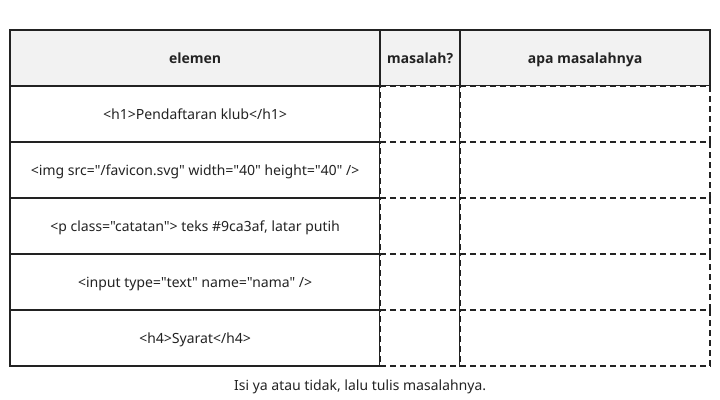

**Ingat dulu:** Tanpa melihat catatan, jawab. (1) Dari mana nama situs yang tampil di build diambil, berurutan dari yang diutamakan? ______ (2) Sebutkan tiga pemeriksaan keamanan sebelum aplikasi data diserahkan. ______



`[Gambar: tabel lima baris elemen: h1 Pendaftaran klub, img favicon.svg, p kelas catatan berwarna abu di atas putih, input teks nama, dan h4 Syarat. Kolom masalah dan kolom apa masalahnya kosong untuk diisi.]`

**Prediksi:** Tebak dulu, tulis jawabanmu, baru jalankan (`AI: tanpa AI`). Kelas `.catatan` berwarna `#9ca3af` di atas latar putih. Berkas ini memakai `<html lang="id">` dan `<title>`.

```astro
<body>
  <h1>Pendaftaran klub</h1>
  
  <p class="catatan">Isi formulir sebelum Jumat.</p>
  <input type="text" name="nama" />
  <h4>Syarat</h4>
</body>
```

Isi tabel pada gambar. Menurutmu, berapa rasio kontras `#9ca3af` di atas putih, dan apakah lolos 4,5:1? ______

**Lengkapi:** Perbaiki formulir agar lolos aturan `label` dan `image-alt`. Isi bagian `____`.

```astro setengah-jadi

<____ for="nama">Nama panggilan</____>
<input ____="nama" type="text" name="nama" />
```

Mengapa `for` pada label harus sama dengan `id` pada kotak isian? ______

**Susun:** Urutkan baris A sampai E menjadi fungsi `kontras` yang benar. Satu baris tidak terpakai. `AI: tanpa AI`.

```text
(A) export function kontras(a: string, b: string): number {
(B)   const [terang, gelap] = [luminans(a), luminans(b)].sort((x, y) => y - x);
(C)   return (terang + 0.05) / (gelap + 0.05);
(D) }
(E)   return (gelap + 0.05) / (terang + 0.05);
```

Urutan: ______ ______ ______ ______ Tidak terpakai: ______

**Latihan:**

1. `AI: tanpa AI` Tebak: apakah teks putih di atas `#6b7484` lolos 4,5:1? Hitung dengan `kontras.ts`. ______
2. `AI: tanpa AI` Mengapa `alt="foto"` lolos axe padahal tidak membantu, dan siapa yang harus menilainya? ______
3. `AI: boleh` Kamu mengganti warna primer menjadi `#facc15` (kuning). Hitung kontras teks putih dan teks hitam di atasnya; mana yang kamu pilih? ______
4. `AI: boleh` Kartu program memakai warna merah untuk "penuh". Apa yang kamu tambahkan agar pembaca yang sulit membedakan warna tetap paham? ______

**Cek diri:**

- [ ] Saya dapat menghitung rasio kontras dan menyatakan lolos atau tidak.
- [ ] Saya dapat menjalankan axe dan membaca hasilnya.
- [ ] Saya dapat menyebut yang tidak ditemukan alat otomatis.

**Catatan cetak (untuk guru, tidak dicetak):** dua halaman A4. Kunci ada di modul `b-xii1-m7`, bagian "Kunci dan petunjuk". Lembar tidak memuat kolom identitas.
