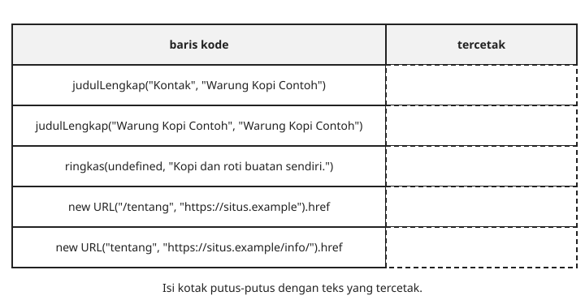

**Ingat dulu:** Tanpa melihat catatan, jawab. (1) Mengapa `alt="foto"` lolos axe padahal tidak membantu pembaca layar, dan siapa yang menilai `alt` gambar? ______ (2) Apa beda "tidak tersambung" dengan status 404 saat mendiagnosis permintaan yang gagal? ______



`[Gambar: tabel dua kolom, baris kode dan tercetak. Lima baris kode: judulLengkap dengan "Kontak", judulLengkap dengan judul sama dengan nama situs, ringkas dengan deskripsi undefined, dan dua pemanggilan new URL. Kolom tercetak kosong untuk diisi.]`

**Prediksi:** Tebak dulu, tulis jawabanmu, baru jalankan (`AI: tanpa AI`). Isi tabel pada gambar.

```ts
function judulLengkap(judul: string, nama: string): string {
  return judul === nama ? judul : `${judul} — ${nama}`;
}
function ringkas(deskripsi: string | undefined, cadangan: string): string {
  return (deskripsi ?? cadangan).slice(0, 20);
}
console.log(judulLengkap("Kontak", "Warung Kopi Contoh"));
console.log(judulLengkap("Warung Kopi Contoh", "Warung Kopi Contoh"));
console.log(ringkas(undefined, "Kopi dan roti buatan sendiri."));
console.log(new URL("/tentang", "https://situs.example").href);
console.log(new URL("tentang", "https://situs.example/info/").href);
```

Mengapa kanonik sebaiknya dibangun dari alamat situs lengkap, bukan `/tentang` saja? ______

**Lengkapi:** `cariKembar` mengembalikan satu baris untuk tiap deskripsi yang dipakai lebih dari satu halaman. Isi bagian `____`.

```ts setengah-jadi
function cariKembar(halaman: { jalur: string; deskripsi: string }[]): string[] {
  const peta = new Map<string, string[]>();
  for (const h of halaman) {
    const daftar = peta.get(h.deskripsi) ?? ____;
    daftar.push(h.jalur);
    peta.set(h.deskripsi, ____);
  }
  const hasil: string[] = [];
  for (const [deskripsi, jalur] of peta) {
    if (jalur.length ____ 1) hasil.push(`${jalur.join(", ")}: ${deskripsi}`);
  }
  return hasil;
}
```

**Susun:** Urutkan baris A sampai I menjadi fungsi pemeriksa kanonik. Satu baris tidak terpakai. `AI: tanpa AI`.

```text
(A)   return temuan;
(B) }
(C) function periksaKanonik(html: string): string[] {
(D)   else if (!kanonik.startsWith("https://")) temuan.push("canonical bukan URL mutlak https");
(E)   const temuan: string[] = [];
(F)   const kanonik = /<link rel="canonical" href="([^"]*)"/.exec(html)?.[1];
(G)   if (kanonik === undefined) temuan.push("tidak ada canonical");
(H)   temuan.push(kanonik);
```

Urutan: ______ ______ ______ ______ ______ ______ ______ Tidak terpakai: ______

**Latihan:**

1. `AI: tanpa AI` Telusuri HTML ini dan tulis semua temuan yang akan dilaporkan `periksaHalaman`: `<html><head><title>Beranda</title><meta name="description" content=""><link rel="canonical" href="https://situs.example/"></head><body><h1>Selamat datang</h1></body></html>`. ______
2. `AI: tanpa AI` Halaman `/draf-harga` belum boleh muncul di hasil pencarian. Seorang teman menambahkan `Disallow: /draf-harga` ke `robots.txt`. Cukupkah, dan apa yang lebih tepat? ______
3. `AI: boleh` Untuk situs profil fiktif dengan halaman Beranda, Layanan, dan Kontak, tulis `<title>` dan deskripsi tiap halaman: semuanya berbeda, deskripsi paling panjang 160 karakter. ______
4. `AI: boleh` Judul halaman diambil dari teks pengunjung dan ditulis ke `<title>` lewat templat string tanpa escape. Apa risikonya, dan perbaikannya? ______

**Cek diri:**

- [ ] Saya dapat menulis judul dan deskripsi unik untuk tiap halaman.
- [ ] Saya dapat menjelaskan fungsi kanonik, `robots.txt`, dan peta situs.
- [ ] Saya tahu `SITE_URL` yang salah tidak menggagalkan build.

**Catatan cetak (untuk guru, tidak dicetak):** dua halaman A4. Kunci ada di modul `b-xii1-m8`, bagian "Kunci dan petunjuk". Lembar tidak memuat kolom identitas.
