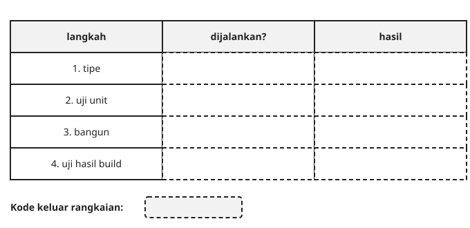

**Ingat dulu:** Tanpa melihat catatan, jawab. (1) Sebutkan empat hal yang diperiksa audit SEO dasar pada tiap halaman. ______ (2) Apa beda `bun run build` dan `bun run dev` pada proyek Astro, dan folder mana yang diserahkan sebagai situs statis? ______



`[Gambar: tabel empat langkah gerbang berurutan: tipe, uji unit, bangun, dan uji hasil build. Kolom dijalankan dan kolom hasil kosong. Di bawahnya satu kotak kosong untuk kode keluar rangkaian.]`

**Prediksi:** Tebak dulu, tulis jawabanmu, baru jalankan (`AI: tanpa AI`). Isi tabel dan kotak kode keluar pada gambar.

```ts
const langkah: [string, () => boolean][] = [
  ["tipe", () => true],
  ["uji unit", () => true],
  ["bangun", () => false],
  ["uji hasil build", () => true],
];
let kode = 0;
for (const [nama, jalan] of langkah) {
  const lolos = jalan();
  console.log(nama, lolos ? "lolos" : "GAGAL");
  if (!lolos) {
    kode = 1;
    break;
  }
}
console.log("kode keluar", kode);
```

Mengapa urutan langkah penting, dan mengapa rangkaian dihentikan pada kegagalan pertama? ______

**Lengkapi:** Lengkapi dua uji ini. Isi bagian `____`.

```ts setengah-jadi
import { expect, test } from "bun:test";
import { urlMutlak } from "./head";

test("jalur tanpa garis miring awal tetap mutlak", () => {
  expect(urlMutlak("https://situs.example", "____")).toBe("https://situs.example/____");
});

test("situs di dalam folder", () => {
  expect(urlMutlak("https://situs.example/info/", "tentang")).____("https://situs.example/info/tentang");
});
```

**Susun:** Urutkan baris A sampai F menjadi berkas uji yang benar. Satu baris tidak terpakai. `AI: tanpa AI`.

```text
(A) });
(B) import { ringkasDeskripsi } from "./head";
(C) expect(ringkasDeskripsi(undefined, "cadangan")).toBe("tidak ada");
(D) test("deskripsi kosong memakai cadangan", () => {
(E) import { expect, test } from "bun:test";
(F)   expect(ringkasDeskripsi(undefined, "cadangan")).toBe("cadangan");
```

Urutan: ______ ______ ______ ______ ______ Tidak terpakai: ______

**Latihan:**

1. `AI: boleh` Tulis dua uji `bun test` untuk `judulLengkap` (judul halaman biasa dan judul yang sama dengan nama situs) dan jalankan. ______
2. `AI: tanpa AI` Ubah sementara `BATAS_DESKRIPSI` dari 160 menjadi 60 di `head.ts` dan jalankan `bun test ./src`. Uji mana yang gagal? Apa artinya bila tidak ada uji yang gagal? ______
3. `AI: boleh` Mengapa audit SEO atas hasil build dijalankan setelah `astro build`, bukan sebelumnya? Apa yang terjadi bila rangkaian memanggilnya lebih dulu? ______
4. `AI: boleh` Semua uji lolos tetapi halaman Kontak masih salah menulis nama situs. Apa yang tidak dibuktikan uji yang lolos itu, dan uji apa yang kamu tambahkan? ______

**Cek diri:**

- [ ] Saya dapat membedakan uji dan gerbang mutu.
- [ ] Saya dapat membaca kode keluar dan menjelaskan fungsi `&&`.
- [ ] Saya dapat menemukan penyebab kegagalan dari keluaran dan memperbaiki sumbernya.

**Catatan cetak (untuk guru, tidak dicetak):** dua halaman A4. Kunci ada di modul `b-xii1-m9`, bagian "Kunci dan petunjuk". Lembar tidak memuat kolom identitas.
