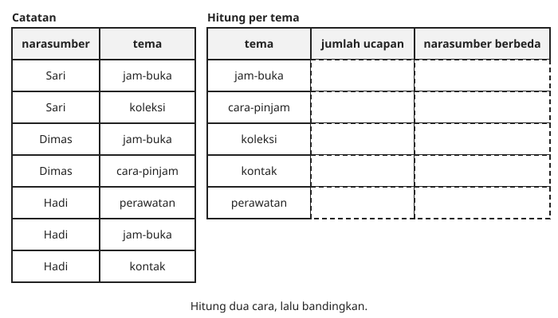

**Ingat dulu:** Tanpa melihat catatan, jawab. (1) Sebutkan empat hal yang membuat sebuah tugas dalam rencana dapat diperiksa orang lain. ______ (2) Mengapa baris yang dihapus pada diff yang memuat rahasia tetap menjadi temuan? ______ (3) Sebutkan tiga hal yang diperiksa pada audit aksesibilitas cepat. ______

`[Gambar: di kiri tujuh catatan wawancara karangan berisi narasumber dan tema. Di kanan tabel lima tema (jam-buka, cara-pinjam, koleksi, kontak, perawatan) dengan kolom jumlah ucapan dan kolom narasumber berbeda yang kosong untuk diisi.]`

**Prediksi:** Tulis **sebelum** mewawancarai: apa tiga hal yang kamu kira akan diminta pengguna fiktifmu, dan apa yang kamu kira tidak akan mereka minta? ______ Bandingkan setelah wawancara; selisihnya adalah pelajaran.

**Lengkapi:** Pada gambar, isi dua kolom kosong untuk tiap tema. Tema dihitung menurut jumlah narasumber yang berbeda, bukan jumlah ucapan. Tema mana yang terkuat? ______ Lalu lengkapi dokumen kebutuhan untuk proyekmu. Kebutuhan adalah hal yang ingin dicapai pengguna, bukan fitur yang kamu pilih.

| Id | Ingin | Agar | Kriteria penerimaan | Prioritas (harus, sebaiknya, nanti) | Dalam lingkup? |
| --- | --- | --- | --- | --- | --- |
| K1 | | | | | |
| K2 | | | | | |
| K3 | | | | | |

**Latihan:**

1. `AI: tanpa AI` Katalog yang bisa dicari butuh basis data dan pencarian, sedangkan proyek ini tidak menyentuh backend. Jika kebutuhan itu kamu tulis dengan prioritas "harus", apa masalahnya dan apa yang kamu lakukan padanya? ______
2. `AI: boleh` Ubah satu tugas dalam rencanamu menjadi tugas yang bisa diperiksa: tulis pemilik, jam (paling lama 4), dan kriteria selesai. ______
3. `AI: tanpa AI` Dari kebutuhan yang kamu tulis, mana yang menyentuh aksesibilitas, dan pemeriksaan cepat apa yang cocok untuknya? ______
4. Tukar dokumen kebutuhan dengan kelompok lain. Tulis ulasan: satu yang sudah baik, satu yang perlu diperbaiki, satu langkah berikutnya. ______

**Cek diri:**

- [ ] Wawancara hanya dengan tokoh karangan; tidak ada nama, kontak, atau data orang nyata.
- [ ] Tema dihitung menurut jumlah narasumber, bukan jumlah ucapan.
- [ ] Tiap kebutuhan punya *ingin*, *agar*, minimal satu kriteria penerimaan, dan prioritas.

**Catatan cetak (untuk guru, tidak dicetak):** dua halaman A4. Modul ini tidak punya soal Parsons. Kunci ada di modul `b-xii2-m1`, bagian "Kunci dan petunjuk". Lembar tidak memuat kolom identitas.
