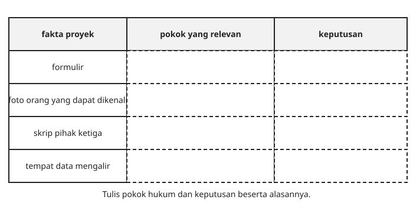

**Ingat dulu:** Tanpa melihat catatan, jawab. (1) Mengapa menghapus berkas rahasia dari commit terbaru tidak cukup, dan apa urutan langkah yang benar? ______ (2) Apa itu rilis kandidat, dan apa yang tidak dibuktikannya? ______ (3) Mengapa data wawancara dalam dokumen kebutuhan harus karangan? ______

`[Gambar: tabel empat baris fakta proyek: formulir, foto orang yang dapat dikenali, skrip pihak ketiga, dan tempat data mengalir. Kolom pokok yang relevan dan kolom keputusan kosong; kamu mengisinya untuk proyekmu.]`

**Prediksi:** Tulis rencana dan prediksimu lebih dulu, sebelum membaca pasal: data apa yang menurutmu diproses situsmu? ______

**Lengkapi:** Isi tabel pada gambar untuk proyekmu. Tiap keputusan memakai salah satu dari: tidak menyimpan, minta persetujuan, ganti, atau buang, dengan alasannya. Pasal dibaca dari naskah resmi dan tanggal akses dicatat; yang tidak dibaca ditandai `[belum terverifikasi]`. Semua data karangan.

**Latihan:**

1. `AI: boleh` Pindaian rahasia menemukan `.env` yang ikut dilacak. Selain pokok keamanan, hukum apa yang relevan bila isinya data pribadi pengunjung? ______
2. `AI: boleh` Formulir latihan hanya menampilkan konfirmasi. Tulis satu kalimat keputusan rancangan tentang data di catatan kepatuhan. ______
3. Tukar catatan kepatuhan dengan kelompok lain. Tulis ulasan: satu yang sudah baik, satu yang perlu diperbaiki, satu langkah berikutnya. Periksa apakah ada klaim hukum tanpa sumber. ______

**Cek diri:**

- [ ] Saya dapat menentukan apakah proyekku memproses data pribadi.
- [ ] Saya dapat menulis catatan kepatuhan dengan fakta, pokok, dan keputusan.
- [ ] Saya tahu apa yang tidak boleh saya klaim: bahwa situs "legal" atau catatan ini nasihat hukum.

**Catatan cetak (untuk guru, tidak dicetak):** dua halaman A4. Modul ini tidak punya soal Parsons; pokok pasal ada pada bagian "Rencana sprint" modul `b-xii2-m10`, dan kunci pada bagian "Kunci dan petunjuk". Catatan kepatuhan bukan nasihat hukum. Lembar tidak memuat kolom identitas.
