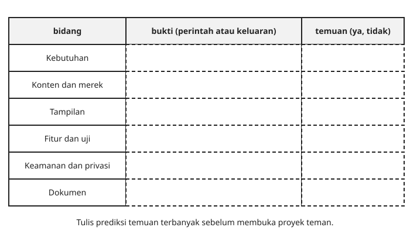

**Ingat dulu:** Tanpa melihat catatan, jawab. (1) Sebutkan tiga hal yang kamu cek sebelum memasang skrip pihak ketiga (penghitung pengunjung, peta, font) dari sisi privasi. ______ (2) Mengapa panduan ditulis dari tujuan pembaca, bukan dari daftar perintah alat? ______ (3) Apa yang harus ada pada komentar ulasan untuk berkas konten teman? ______

`[Gambar: tabel enam baris bidang ulasan: kebutuhan, konten dan merek, tampilan, fitur dan uji, keamanan dan privasi, dan dokumen. Kolom bukti (perintah atau keluaran) dan kolom temuan kosong untuk diisi peninjau.]`

**Prediksi:** Tulis rencana ulasan **sebelum** membuka proyek mereka: dokumen apa yang kamu pegang (kebutuhan dan rancangan mereka), enam bidang yang kamu nilai, dan prediksimu tentang temuan terbanyak. ______

**Lengkapi:** Isi tabel pada gambar untuk proyek kelompok lain. Tiap bidang punya sedikitnya satu bukti (perintah, keluaran, atau tangkapan layar), bukan kesan. Mulai dari ukuran perubahan: `git log --oneline main..<cabang>` dan `git diff --stat main...<cabang>`. Tulis tingkat tiap komentar bukan-pujian (henti, tanya) beserta temuan, alasan, dan saran, dan sedikitnya satu hal yang sudah baik. ______

**Latihan:**

1. `AI: boleh` Dalam ulasan, kamu menemukan `.env` ikut dilacak di proyek teman. Tulis komentarnya dengan temuan, alasan, saran, dan tingkat. ______
2. `AI: boleh` Proyek teman memasang penghitung pengunjung pihak ketiga tanpa menyebutnya di catatan kepatuhan. Tulis komentar yang berupa pertanyaan. ______
3. `AI: tanpa AI` Sebuah rangkuman ulasan hanya memeriksa bentuk catatan. Penilaian apa yang tetap harus kamu lakukan sendiri, dan bagaimana membuktikannya? ______
4. Tulis tanggapan atas satu ulasan untuk proyekmu: memperbaiki, atau bertanya dan menunjukkan bukti. ______

**Cek diri:**

- [ ] Rencana ulasan ada sebelum membuka proyek: dokumen yang dipegang, bidang, prediksi.
- [ ] Setiap komentar bukan-pujian punya temuan, alasan, saran, dan tingkat.
- [ ] Komentar ditujukan ke kode, bukan ke orangnya.

**Catatan cetak (untuk guru, tidak dicetak):** dua halaman A4. Modul ini tidak punya soal Parsons. Kunci ada di modul `b-xii2-m11`, bagian "Kunci dan petunjuk". Lembar tidak memuat kolom identitas.
