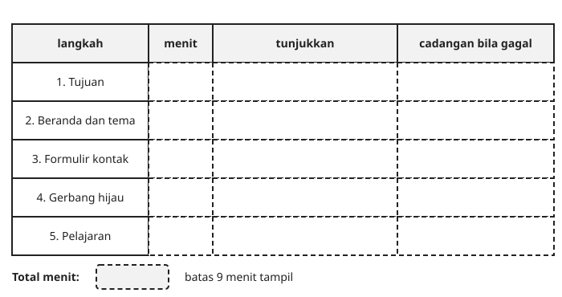

**Ingat dulu:** Tanpa melihat catatan, jawab. (1) Apa beda temuan yang menghentikan penggabungan dengan pertanyaan, dan mengapa ulasan juga menyebut yang sudah baik? ______ (2) Apa yang dikirim `bun audit` ke luar komputer, dan apa arti kode keluar 1? ______ (3) Bukti apa yang kamu tunjukkan saat mempresentasikan tampilan, selain tangkapan layar? ______

`[Gambar: tabel lima langkah demo: tujuan, beranda dan tema, formulir kontak, gerbang hijau, dan pelajaran. Kolom menit, tunjukkan, dan cadangan bila gagal kosong. Di bawahnya satu kotak kosong untuk total menit dengan batas 9 menit tampil.]`

**Prediksi:** Tulis rencana demo **sebelum** berlatih: apa yang ingin dilihat penonton, urutan langkah, waktu, dan apa yang kamu lakukan bila langkah gagal. Langkah mana yang paling mungkin gagal? ______

**Lengkapi:** Isi tabel pada gambar untuk demo proyekmu. Tiap langkah punya hal yang ditunjukkan dan cadangan yang tidak bergantung pada server atau jaringan. Total waktu jangan melebihi batas dan jangan nyaris tanpa sisa. Semua data di layar karangan. Sebutkan satu hal yang belum beres dan temuan ulasan yang belum dikerjakan. ______

**Latihan:**

1. `AI: tanpa AI` Sebuah rencana demo punya batas 9 menit dan total langkahnya 9 menit, dan satu langkah belum punya cadangan. Temuan apa yang kamu laporkan, dan apa perbaikannya? ______
2. `AI: boleh` Tulis dua kalimat yang kamu ucapkan tentang hasil ulasan keamananmu, termasuk satu hal yang tidak diperiksa. ______
3. `AI: boleh` Penonton bertanya, "Apakah situsmu menyimpan data pengunjung?" Tulis jawaban satu kalimat yang cocok dengan catatan kepatuhanmu dan tidak melebih-lebihkan. ______
4. Setelah demo, tulis umpan balik untuk teman: satu yang sudah baik, satu yang perlu diperbaiki, satu langkah berikutnya. Fokus pada apa yang terlihat dan terdengar. ______

**Cek diri:**

- [ ] Setiap langkah punya hal yang ditunjukkan dan cadangan yang tidak bergantung pada server atau jaringan.
- [ ] Layar bersih: tidak ada `.env`, rahasia, atau data pribadi tampil.
- [ ] Temuan ulasan dan hal yang belum beres disebut jujur.

**Catatan cetak (untuk guru, tidak dicetak):** dua halaman A4. Modul ini tidak punya soal Parsons. Kunci ada di modul `b-xii2-m12`, bagian "Kunci dan petunjuk". Lembar tidak memuat kolom identitas.
