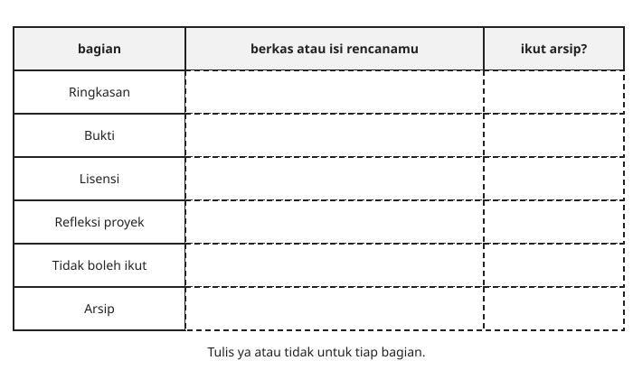

**Ingat dulu:** Tanpa melihat catatan, jawab. (1) Mengapa demo diberi cadangan yang tidak bergantung pada server hidup atau jaringan? ______ (2) Mengapa "tidak menyimpan data pribadi" dicatat sebagai keputusan rancangan, dan apa yang dicek ulang bila fitur berubah menjadi menyimpan? ______ (3) Apa yang kamu catat tentang fitur yang tidak dikerjakan karena di luar lingkup? ______

`[Gambar: tabel enam bagian portofolio: ringkasan, bukti, lisensi, refleksi proyek, tidak boleh ikut, dan arsip. Kolom berkas atau isi rencanamu dan kolom ikut arsip kosong untuk diisi.]`

**Prediksi:** Tulis rencana portofolio **sebelum** mengumpulkan berkas: siapa pembacanya, apa yang harus terbukti, dan apa yang tidak boleh ikut. Berkas mana yang paling mungkin tak sengaja ikut? ______

**Lengkapi:** Isi tabel pada gambar untuk proyekmu, dan tulis ya atau tidak pada kolom ikut arsip. Arsip dibuat dari commit bertag dengan `git archive`, bukan dengan menyalin folder. `refleksi.md` ikut portofolio dan hanya memuat yang siap dibaca guru; jurnal pribadimu tidak diserahkan.

**Latihan:**

1. `AI: tanpa AI` Aturan pemeriksa portofolio: berkas wajib `README.md`, `LICENSE`, dan `refleksi.md`; bukti sedikitnya tiga di `bukti/`; tidak ada berkas lingkungan atau kunci. Daftar isi sebuah arsip: `README.md`, `LICENSE`, `bukti/gerbang.txt`, `bukti/uji.txt`, `.env.local`, `kunci.pem`. Tulis semua temuannya. ______
2. `AI: tanpa AI` Mengapa pemeriksa yang hanya membaca nama berkas belum cukup, dan apa yang kamu lakukan sebelum arsip dibagikan? ______
3. `AI: boleh` Tulis satu kalimat di `README.md` portofolio yang jujur tentang data: apa yang disimpan situsmu dan apa yang tidak. ______
4. `AI: boleh` Tulis perintah yang kamu jalankan sebelum menyerahkan arsip untuk memastikan tidak ada rahasia di berkas maupun riwayat. ______

**Cek diri:**

- [ ] `README.md` menyatakan tujuan, lingkup, dan cara menjalankan dengan perintah yang benar-benar ada.
- [ ] Folder `bukti/` memuat sedikitnya tiga bukti nyata.
- [ ] Tidak ada `.env`, kunci, data pribadi nyata, atau foto teman di arsip.

**Catatan cetak (untuk guru, tidak dicetak):** dua halaman A4. Modul ini tidak punya soal Parsons. Kunci ada di modul `b-xii2-m13`, bagian "Kunci dan petunjuk". Penyerahan arsip memakai cara yang disediakan guru. Lembar tidak memuat kolom identitas.
