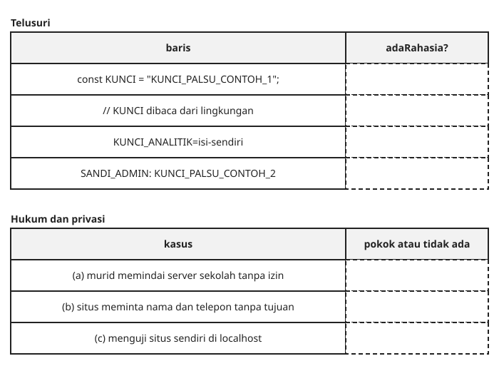

**Ingat dulu:** Tanpa melihat catatan, jawab. (1) Mengapa arsip portofolio dibuat dari commit bertag dengan `git archive`, bukan dengan menyalin folder? ______ (2) Bagaimana kamu menanggapi komentar ulasan yang tidak kamu setujui? ______ (3) Apa beda temuan, penyebab, dan perbaikan pada laporan uji? ______



`[Gambar: dua tabel. Tabel Telusuri punya empat baris kode dengan kolom hasil adaRahasia kosong. Tabel Hukum dan privasi punya tiga kasus (a) sampai (c) dengan kolom pokok atau tidak ada yang kosong.]`

**Latihan:** Kerjakan sendiri, `AI: tanpa AI`, dalam waktu yang ditetapkan gurumu.

1. **Tulis.** Tulis fungsi `siapkanPesan(pesan: unknown)` untuk formulir kontak latihan: status 400 bila bukan teks atau kosong, 400 bila lebih dari 200 karakter, dan 200 dengan teks konfirmasi yang meng-escape tanda kurung sudut. Sebut satu hal yang sengaja tidak dilakukan fungsi itu. ______
2. **Telusuri.** Fungsi `adaRahasia(baris)` memakai pola nama berisi `KUNCI`, `TOKEN`, `SANDI`, dan sejenisnya diikuti `=` atau `:` serta nilai, tetapi mengabaikan nilai `isi-sendiri`. Tebak hasil untuk empat baris pada tabel Telusuri di gambar.
3. **Ulas.** Temukan sedikitnya tiga masalah keamanan atau privasi pada kode berikut dan tulis perbaikannya. ______

   ```ts
   const kunci = "KUNCI_PALSU_CONTOH_1";
   const alamat = new URL(location.href);
   const telepon = alamat.searchParams.get("telepon") ?? "";
   localStorage.setItem("telepon", telepon);
   document.querySelector("#sapa")!.innerHTML = "Halo, " + (alamat.searchParams.get("nama") ?? "tamu");
   console.log("memakai kunci", kunci);
   ```

4. **Hukum dan privasi.** Untuk tiap kasus karangan pada gambar, sebut pokok pada UU ITE, KUHP (UU 1/2023), atau UU PDP yang menyentuhnya, atau "tidak ada". Catatanmu bukan nasihat hukum.
5. **Dokumen.** Perbaiki panduan berikut dan tambahkan yang kurang. ______

   ```text
   # Mengubah warna
   1. Jalankan `bun run lint` dan `bun run check`.
   2. Isi TOKEN_ADMIN=TOKEN_PALSU_CONTOH_9 di berkas pengaturan.
   ```

**Cek diri:**

- [ ] Saya dapat menulis penanganan formulir yang aman dan tidak menyimpan data.
- [ ] Saya dapat menelusuri pemindai rahasia dan mengulas kode dari sisi keamanan dan privasi.
- [ ] Saya dapat menyebut pokok hukum dengan sumbernya tanpa menafsirkannya.

**Catatan cetak (untuk guru, tidak dicetak):** dua halaman A4, dikerjakan mandiri sesuai waktu yang ditetapkan guru. Kunci ada di modul `b-xii2-m14`, bagian "Kunci dan petunjuk". Soal praktik dan refleksi pada modul tidak dimuat. Lembar tidak memuat kolom identitas.
