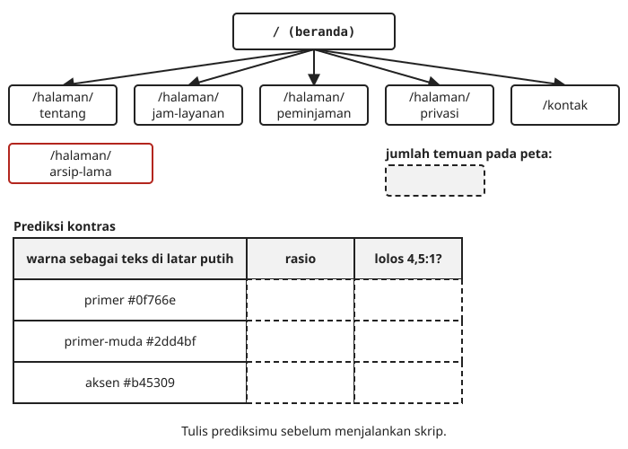

**Ingat dulu:** Tanpa melihat catatan, jawab. (1) Mengapa catatan wawancara dihitung menurut jumlah narasumber, bukan jumlah ucapan? ______ (2) Apa yang terjadi bila `SITE_URL` salah, dan mengapa build tetap sukses? ______



`[Gambar: di atas peta halaman. Beranda (/) tertaut ke empat halaman CMS dan /kontak. Halaman /halaman/arsip-lama digambar sebagai kotak terpisah dengan tepi merah. Ada satu kotak kosong untuk jumlah temuan pada peta. Di bawah tabel tiga warna (primer #0f766e, primer-muda #2dd4bf, aksen #b45309) dengan kolom rasio dan lolos kosong.]`

**Prediksi:** Tulis prediksimu sebelum menjalankan skrip. Berapa temuan yang akan muncul pada peta, bila aturannya: judul tiap halaman berbeda, tiap halaman tertaut dari halaman lain, tiap halaman melayani kebutuhan, dan halaman CMS paling banyak empat? ______ Isi kotak pada gambar. Lalu perkirakan rasio tiap warna sebagai teks di latar putih dan isi tabel kontras (batas teks biasa 4,5:1).

**Lengkapi:** Fungsi rasio kontras (rumus WCAG 2.2). Isi bagian `____`.

```ts setengah-jadi
export function kontras(a: string, b: string): number {
  const [terang, gelap] = [luminans(a), luminans(b)].sort((x, y) => ____);
  return (terang + ____) / (gelap + ____);
}
```

**Latihan:**

1. `AI: boleh` Dari peta, tulis judul dan deskripsi untuk halaman Peminjaman buku, lalu hitung panjangnya terhadap batas: judul di bawah 60 karakter dengan akhiran nama situs, deskripsi di bawah 160. ______
2. `AI: tanpa AI` Dari tiga warna pada gambar, mana yang aman sebagai latar teks putih, dan mana yang hanya aman bila teksnya hitam? ______
3. `AI: tanpa AI` Mengapa rencana menyatakan apa yang tidak dikerjakan, dan apa batas proyek kustomisasi ini? ______
4. Tukar rancangan dengan kelompok lain. Tulis ulasan: satu yang sudah baik, satu yang perlu diperbaiki, satu langkah berikutnya. Periksa apakah tiap halaman melayani kebutuhan. ______

**Cek diri:**

- [ ] Tiap halaman punya judul, deskripsi, dan kebutuhan yang dilayani.
- [ ] Warna merek dan rasio kontrasnya tercatat; teks biasa minimal 4,5:1.
- [ ] Nama, alamat, dan kontak karangan.

**Catatan cetak (untuk guru, tidak dicetak):** dua halaman A4. Modul ini tidak punya soal Parsons. Kunci ada di modul `b-xii2-m2`, bagian "Kunci dan petunjuk". Lembar tidak memuat kolom identitas.
