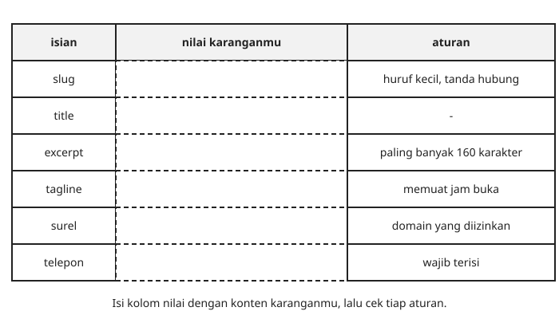

**Ingat dulu:** Tanpa melihat catatan, jawab. (1) Sebutkan enam hal yang diperiksa pada peta situs. ______ (2) Apa yang dibuktikan dan tidak dibuktikan oleh gerbang yang hijau? ______

`[Gambar: tabel enam isian konten: slug, title, excerpt, tagline, surel, dan telepon. Kolom nilai karanganmu kosong. Kolom aturan memuat sebagian aturan: slug huruf kecil dengan tanda hubung, excerpt paling banyak 160 karakter, tagline memuat jam buka, dan telepon wajib terisi.]`

**Prediksi:** Konten ada di dua berkas dalam `tools/seed-data/profil/landing/`: `pages.json` (halaman) dan `site-profile.json` (tagline, alamat, kontak). Tulis prediksimu dulu: apa saja yang akan ditandai skrip pemeriksa konten pada konten bawaan template? ______

**Lengkapi:** Tulis konten karanganmu pada tabel di gambar. Satu halaman `pages.json` punya `slug`, `title`, `pageType`, `excerpt`, dan `bodyParagraphs`. `excerpt` menjadi ringkasan di halaman dan, bila tidak ada deskripsi lain, deskripsi untuk mesin pencari. Semua nama, surel, dan telepon karangan. Surel memakai domain yang diizinkan repositori, dan telepon wajib terisi. ______

**Latihan:**

1. `AI: tanpa AI` Uji repositori hanya mengizinkan surel berdomain `example.com`, `example.id`, `example.net`, dan `example.org`, dan mewajibkan `contactPhone` terisi. Kamu menulis `info@perpus-contoh.example` dengan telepon `null`. Apa temuan yang kamu harapkan, dan apa perbaikannya? ______
2. `AI: tanpa AI` Dry-run seed tanpa jaringan hanya membuktikan bentuk berkas. Apa yang tidak dibuktikannya? ______
3. `AI: boleh` Ubah tagline agar memuat satu hal selain jam buka, lalu hitung panjangnya. Mana yang menang bila `SITE_DESCRIPTION` dan CMS sama-sama terisi? ______
4. `AI: tanpa AI` Dari tiga pemeriksaan (skrip pemeriksa konten, uji repositori, dan `--dry-run`), mana yang berupa gerbang lolos atau gagal, dan apa yang tetap hanya bisa dinilai manusia? ______
5. Tukar berkas konten dengan kelompok lain. Tulis ulasan pada satu halaman: temuan dan saran. Periksa apakah ada klaim tanpa bukti dan apakah ada data nyata. ______

**Cek diri:**

- [ ] Empat halaman atau kurang; slug huruf kecil dengan tanda hubung.
- [ ] Tagline memuat jam buka; surel `example.org`; telepon placeholder.
- [ ] Tidak ada data orang atau organisasi nyata.

**Catatan cetak (untuk guru, tidak dicetak):** dua halaman A4. Modul ini tidak punya soal Parsons. Kunci ada di modul `b-xii2-m3`, bagian "Kunci dan petunjuk". Lembar tidak memuat kolom identitas.
