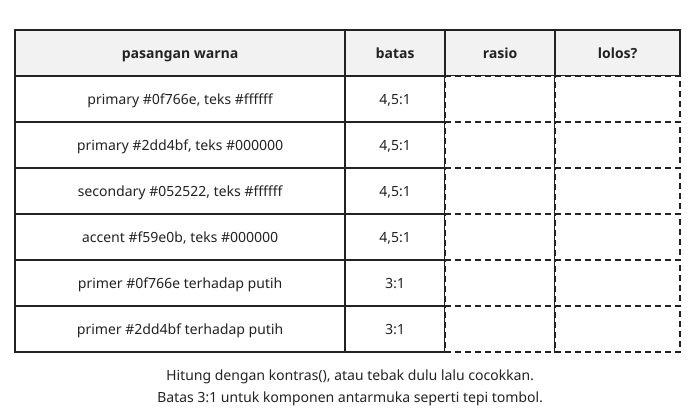

**Ingat dulu:** Tanpa melihat catatan, jawab. (1) Pemeriksaan apa yang dijalankan pada konten sebelum build, dan berapa halaman paling banyak menurut uji repositori? ______ (2) Apa yang kamu periksa pada sebuah permintaan ke asisten AI sebelum mengirimnya? ______

`[Gambar: tabel enam baris pasangan warna. Empat baris pasangan warna dan teks dengan batas 4,5:1: primary #0f766e dengan teks putih, primary #2dd4bf dengan teks hitam, secondary #052522 dengan teks putih, accent #f59e0b dengan teks hitam. Dua baris primer #0f766e dan #2dd4bf terhadap putih dengan batas 3:1. Kolom rasio dan lolos kosong untuk diisi.]`

**Prediksi:** Tulis prediksimu: bila primer menjadi `#2dd4bf`, apakah teks pada tombol tetap terbaca? Apakah warna itu sendiri tetap terlihat jelas di atas latar putih? ______ Lalu isi tabel pada gambar. Fungsi `contrastingForeground` memilih putih atau hitam, mana yang kontrasnya lebih tinggi.

**Lengkapi:** Jalankan selalu `--dry-run` lebih dulu sebelum mengganti warna. Tulis perintah `template:init` untuk warna primer pilihanmu, berkas yang kamu harapkan berubah, dan prediksimu. ______

**Latihan:**

1. `AI: tanpa AI` Mengapa kontras teks tombol hampir selalu lolos 4,5:1, padahal warna itu sendiri di atas latar halaman tidak dijamin? ______
2. `AI: boleh` Tambahkan `--warna-aksen` pada perintah `template:init` dan jelaskan berkas apa yang berubah (`--dry-run` dulu). ______
3. `AI: tanpa AI` Skrip kontras di `b-xii2-m2` dan `periksa-tema.ts` menghitung rasio dengan dua kode berbeda. Apa risikonya, dan bagaimana kamu memastikan keduanya sepakat? ______
4. Tukar catatan tampilan dengan kelompok lain. Tulis ulasan: satu yang sudah baik, satu yang perlu diperbaiki, satu langkah berikutnya. Periksa apakah kontras dihitung dari warna yang dipakai dan apakah pengamatan dibedakan dari bukti. ______

**Cek diri:**

- [ ] Warna merek tercatat beserta rasionya; pasangan teks minimal 4,5:1, primer terhadap putih minimal 3:1.
- [ ] Hasil build dibuka pada dua lebar (sekitar 390 dan 1200) dan pengamatan dicatat.
- [ ] `--dry-run` dijalankan lebih dulu.

**Catatan cetak (untuk guru, tidak dicetak):** dua halaman A4. Modul ini tidak punya soal Parsons. Kunci ada di modul `b-xii2-m4`, bagian "Kunci dan petunjuk". Lembar tidak memuat kolom identitas.
