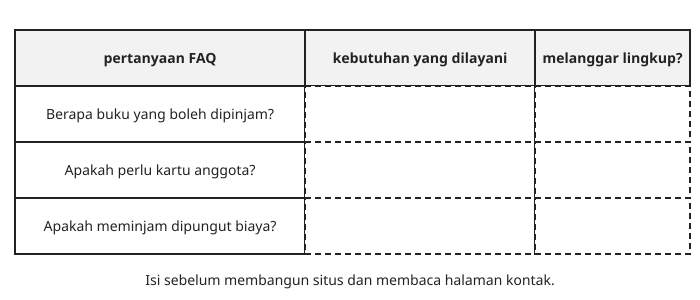

**Ingat dulu:** Tanpa melihat catatan, jawab. (1) Dari mana warna tema berasal pada build tanpa CMS, dan perintah apa mengubahnya? ______ (2) Apa tiga hal yang harus ada pada atribusi konten berlisensi CC BY 4.0? ______

`[Gambar: tabel tiga baris pertanyaan FAQ: berapa buku yang boleh dipinjam, apakah perlu kartu anggota, dan apakah meminjam dipungut biaya. Kolom kebutuhan yang dilayani dan kolom melanggar lingkup kosong untuk diisi.]`

**Prediksi:** Tulis prediksimu: dari tiga pertanyaan FAQ pada gambar, apa kebutuhan yang dilayani masing-masing, dan adakah yang melanggar lingkup? Isi tabel. ______ Halaman kontak bawaan tidak punya formulir.

**Lengkapi:** Tulis alasan untuk tiap keputusan rancangan formulir kontak latihan.

| Keputusan | Alasan |
| --- | --- |
| `<label>` terhubung dan galat per kolom lewat `aria-describedby` | |
| ringkasan `role="alert"`, konfirmasi `role="status"` | |
| `novalidate` | |
| kolom jebakan disingkirkan dengan `position: absolute; left: -10000px`, bukan `display: none` | |
| gaya dan skrip di berkas terpisah, bukan sebaris | |

**Latihan:**

1. `AI: tanpa AI` Mengapa halaman `/kontak` harus dibaca teks yang benar-benar tampil setelah pratinjau, bukan hanya dibuka tanpa pratinjau? ______
2. `AI: tanpa AI` Mengapa formulir latihan ini belum boleh menerima pesan sungguhan? Sebut dua alasan. ______
3. `AI: boleh` Tambahkan satu pertanyaan FAQ yang mengutip sumber lisensi dan tulis atribusinya. Dokumen mana yang ikut berubah? ______
4. `AI: tanpa AI` Surel apa yang kamu pakai pada data uji formulir, dan mengapa `.example` saja tidak cukup bila datanya masuk berkas seed? ______
5. Coba formulir kelompok lain dengan masukan sah, kosong, dan terlalu panjang. Tulis ulasan: satu yang sudah baik, satu yang perlu diperbaiki, satu langkah berikutnya. ______

**Cek diri:**

- [ ] Setiap fitur menunjuk kebutuhan K.
- [ ] Formulir tanpa `fetch`, penyimpanan, atau `action`; uji lolos; tab Network kosong; dicoba dengan papan ketik.
- [ ] Fitur di luar lingkup dicatat sebagai usulan.

**Catatan cetak (untuk guru, tidak dicetak):** dua halaman A4. Modul ini tidak punya soal Parsons; kode formulir ada pada bagian "Rencana sprint" modul `b-xii2-m5`. Kunci ada pada bagian "Kunci dan petunjuk". Lembar tidak memuat kolom identitas.
