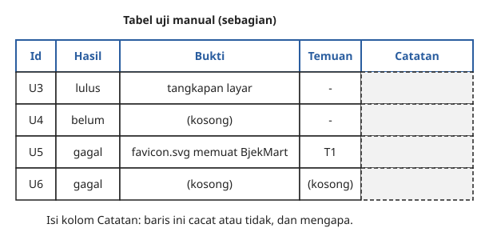

**Ingat dulu:** Tanpa melihat catatan, jawab: (1) Mengapa formulir kontak di situsmu tidak mengirim atau menyimpan isian? (2) Mengapa surel contoh di berkas seed memakai `example.org`?

1. ______
2. ______



`[Gambar: tabel empat baris uji U3 sampai U6 dengan kolom Id, Hasil, Bukti, Temuan, dan Catatan. U3 lulus dengan bukti tangkapan layar. U4 belum tanpa bukti. U5 gagal dengan bukti favicon.svg memuat BjekMart dan temuan T1. U6 gagal tanpa bukti dan tanpa temuan. Kolom Catatan kosong: isi apakah baris cacat dan mengapa.]`

**Prediksi:** Pemeriksa hasil build dijalankan pada situs yang `favicon.svg`-nya masih berlabel merek template. Berapa temuan yang kamu kira muncul? ______ Mengapa uji repositori tidak menangkapnya? ______

**Lengkapi:** Skrip ringkasan uji menandai baris cacat.

```ts setengah-jadi
for (const u of uji) {
  hitung[u.hasil]++;
  if (u.hasil !== "belum" && u.bukti.trim() === "") masalah.push(`${u.id}: hasil ${u.hasil} tanpa bukti`);
  if (u.hasil === "gagal" && ______) masalah.push(`${u.id}: gagal tetapi belum ada temuan`);
}
```

**Susun:** Urutkan perintah agar berhenti pada langkah pertama yang gagal. Tulis urutan huruf: ______

- A. `bun run periksa-dist.ts`
- B. `bun run periksa-konten.ts`
- C. `bun test tests/seed-profil.test.mjs`
- D. `bun --bun astro build ...`

**Latihan:**

1. `AI: tanpa AI` Tulis tiga uji manual untuk halaman kontak (telepon, FAQ, tombol surel) dengan langkah dan harapan, tanpa menjalankannya dulu.

   ______

2. `AI: boleh` Mengapa perintah di atas disambung dengan `&&`? ______

3. Tulis kerangka laporan temuan untuk ikon situs yang masih berlabel merek template. ______

**Cek diri:**

- [ ] Saya dapat menulis uji manual yang menunjuk kebutuhan dan memuat bukti.
- [ ] Saya dapat menyebut yang dibuktikan dan tidak dibuktikan uji otomatis dan manual.

**Catatan cetak (untuk guru, tidak dicetak):** satu halaman A4. Kunci ada di modul `b-xii2-m6` bagian "Kunci dan petunjuk". Lembar tidak memuat kolom identitas.
