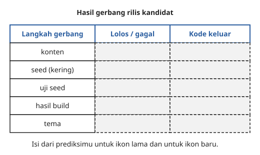

**Ingat dulu:** Tanpa melihat catatan, jawab: (1) Mengapa hasil uji manual harus mencatat langkah dan bukti nyata, bukan hanya "OK"? (2) Mengapa gerbang hijau di `main` dicatat sebagai garis dasar sebelum mulai?

1. ______
2. ______



`[Gambar: tabel lima baris langkah gerbang (konten, seed kering, uji seed, hasil build, tema) dengan kolom lolos atau gagal dan kolom kode keluar yang kosong. Isi tabel dua kali di kertas: untuk ikon lama dan untuk ikon baru, sesuai prediksimu.]`

**Prediksi:** Bila `favicon.svg` diganti, apakah semua langkah gerbang lolos? ______ Berapa pelanggaran yang akan dilaporkan alat aksesibilitas, dan aturan apa yang mungkin tidak bisa diputuskan mesin? ______

**Lengkapi:** Skrip gerbang menjalankan semua langkah dan tidak berhenti di yang pertama gagal.

```ts setengah-jadi
let gagal = 0;
for (const l of langkah) {
  const hasil = Bun.spawnSync(l.perintah, { stdout: "ignore", stderr: "ignore" });
  const lolos = hasil.exitCode === ______;
  if (!lolos) ______;
  console.log(`${lolos ? "LOLOS" : "GAGAL"}  ${l.nama} (kode keluar ${hasil.exitCode})`);
}
process.exit(gagal === 0 ? 0 : 1);
```

**Susun:** Urutkan langkah perbaikan temuan T1 (ikon merek template). Urutan huruf: ______

- A. Bangun ulang situs
- B. Ganti `apps/storefront/public/favicon.svg` dengan ikon sendiri
- C. Jalankan `kandidat.ts`
- D. Jalankan `bun test`

**Latihan:**

1. `AI: boleh` Buat daftar tiga hal yang tidak ditangkap axe di situs ini dan cara memeriksanya dengan mata atau papan ketik. ______
2. `AI: tanpa AI` Peta situsmu berisi halaman yang kini tidak ada di build. Tulis satu pemeriksaan yang membandingkan peta dengan `sitemap-1.xml` hasil build. ______
3. Mengapa perbaikan di sprint terakhir dibatasi (fitur dibekukan)? Sebut tiga alasan. ______

**Cek diri:**

- [ ] Saya dapat memilah temuan menurut lingkup dan siapa yang memperbaiki.
- [ ] Saya dapat menyebut yang dibuktikan dan tidak dibuktikan rilis kandidat.

**Catatan cetak (untuk guru, tidak dicetak):** satu halaman A4. Kunci ada di modul `b-xii2-m7` bagian "Kunci dan petunjuk". Lembar tidak memuat kolom identitas.
