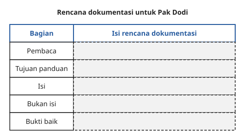

**Ingat dulu:** Tanpa melihat catatan, jawab: (1) Mengapa FAQ tidak ada di berkas seed, dan siapa yang mengisinya di CMS lab? (2) Apa yang diwajibkan lisensi MIT pada setiap salinan?

1. ______
2. ______



`[Gambar: tabel dua kolom, Bagian dan Isi rencana dokumentasi. Lima baris: Pembaca, Tujuan panduan, Isi, Bukan isi, Bukti baik. Semua kolom isi kosong. Pengguna fiktif: Pak Dodi, pemilik Warung Kopi Contoh, yang ingin mengubah jam buka. Isi tabel di kertas sebelum menulis panduan.]`

**Prediksi:** Dari panduan yang kamu tulis, berapa kali teman yang mengikutinya akan berhenti? ______ Langkah mana yang menurutmu paling mungkin membuatnya berhenti? ______

**Lengkapi:** Pemeriksa naskah panduan menandai langkah bernomor yang memuat lebih dari satu perintah.

```ts setengah-jadi
const perintah = [...baris.matchAll(/`bun run ([\w:.-]+)[^`]*`/g)];
for (const p of perintah) {
  if (!skrip.has(p[1] ?? "")) temuan.push(`baris ${no}: skrip "${p[1]}" tidak ada`);
}
if (/^\d+\./.test(baris) && perintah.length ______ 1) {
  temuan.push(`baris ${no}: satu langkah memuat ${perintah.length} perintah`);
}
if (!adaJikaGagal) temuan.push(______);
```

**Susun:** Urutkan kerja sprint dokumentasi. Urutan huruf: ______

- A. Teman mengikuti panduan tanpa bantuan dan mencatat tempat ia berhenti
- B. Tulis rencana dokumentasi dengan pembaca nyata
- C. Perbaiki panduan dari catatan teman
- D. Jalankan pemeriksa naskah dan periksa semua perintah

**Latihan:**

1. `AI: boleh` Panduan menyebut "isi formulir lalu data tersimpan". Apa yang salah dari sisi privasi, dan bagaimana kalimatnya diperbaiki? ______
2. `AI: boleh` Tulis bagian panduan tentang berkas `.env` untuk variabel `SITE_URL` tanpa memuat nilai rahasia, dan sebut berkas contoh yang boleh ikut repositori. ______
3. Mengapa satu langkah panduan hanya memuat satu perintah? ______

**Cek diri:**

- [ ] Saya dapat menulis bagian "Jika gagal" yang memberi langkah pertama.
- [ ] Saya dapat memperbarui cermin terjemahan setelah mengubah dokumen.

**Catatan cetak (untuk guru, tidak dicetak):** satu halaman A4. Kunci ada di modul `b-xii2-m8` bagian "Kunci dan petunjuk". Lembar tidak memuat kolom identitas.
