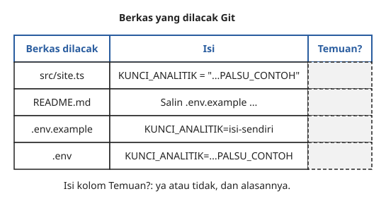

**Ingat dulu:** Tanpa melihat catatan, jawab: (1) Mengapa satu langkah panduan hanya memuat satu perintah? (2) Mengapa kriteria penerimaan ditulis sebelum halaman dibuat?

1. ______
2. ______



`[Gambar: tabel empat berkas yang dilacak Git beserta isinya: src/site.ts memuat KUNCI_ANALITIK, README.md menyebut salin .env.example, .env.example berisi KUNCI_ANALITIK=isi-sendiri, dan .env berisi KUNCI_ANALITIK dengan nilai palsu. Kolom Temuan kosong: tulis ya atau tidak untuk tiap berkas, beserta alasannya.]`

**Prediksi:** Pemindai rahasia dijalankan pada empat berkas di gambar. Berapa temuan yang akan dilaporkan? ______ Bila sebuah rahasia sudah dihapus pada commit terbaru, apakah riwayat masih bersih? ______

**Lengkapi:** Fungsi ini membuat teks aman ditampilkan sebagai HTML.

```ts setengah-jadi
function escapeHtml(teks: string): string {
  return teks
    .replaceAll("&", "______")
    .replaceAll("<", "______")
    .replaceAll(">", "______")
    .replaceAll('"', "______")
    .replaceAll("'", "______");
}
```

**Susun:** Urutkan ulasan keamanan proyek latihan. Urutan huruf: ______

- A. Jalankan `bun audit` dan putuskan tiap temuan
- B. Tulis rencana ulasan dan prediksi
- C. Pindai berkas dilacak dan riwayat dengan `git log -S`
- D. Tulis laporan: temuan, tingkat, bukti, perbaikan, hal yang tidak diperiksa
- E. Uji formulir dengan masukan kosong, panjang, dan bertanda kurung sudut

**Latihan:**

1. `AI: boleh` Tulis satu baris laporan uji manual untuk formulir kontak dengan pesan kosong: langkah, hasil yang diharapkan, hasil nyata. ______
2. `AI: boleh` Dari kebutuhan "pengunjung dapat bertanya tanpa memberi data pribadi", tulis dua pemeriksaan keamanan yang membuktikannya. ______
3. Apa yang dikirim `bun audit` ke luar komputer, dan apa arti kode keluar 1? ______

**Cek diri:**

- [ ] Saya dapat memeriksa rahasia di berkas dan riwayat Git.
- [ ] Saya tahu bahwa saya hanya memeriksa proyek milik sendiri.

**Catatan cetak (untuk guru, tidak dicetak):** satu halaman A4. Kunci ada di modul `b-xii2-m9` bagian "Kunci dan petunjuk". Lembar tidak memuat kolom identitas.
