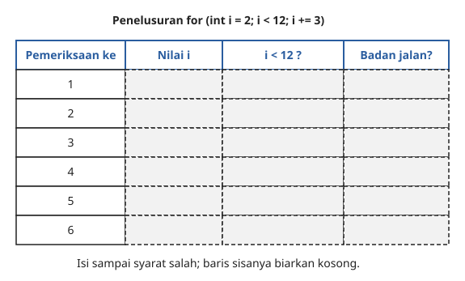

**Ingat dulu:** Tanpa melihat catatan: (1) Satuan `delay` adalah milidetik. Berapa detik lamanya `delay(250)`? (2) Ubah bilangan biner 1011 menjadi desimal. (3) Tulis kondisi `if` agar LED menyala bila tombol A atau tombol B ditekan (ditekan terbaca `LOW`).

1. ______
2. ______
3. ______



`[Gambar: tabel enam baris pemeriksaan untuk for (int i = 2; i < 12; i += 3). Kolom: pemeriksaan ke, nilai i, apakah i < 12, dan apakah badan berjalan. Semua sel kosong. Isi sampai syarat salah, sisanya dibiarkan kosong.]`

**Prediksi:** Program mencetak ke monitor serial dengan `for (int i = 1; i <= 7; i += 2) { Serial.println(i); }`. (1) Apa saja yang tercetak, berurutan? ______ (2) Berapa kali badan dijalankan? ______ (3) Apa yang tercetak bila `i <= 7` diganti `i < 7`? ______

**Lengkapi:** Lampu berjalan maju lalu mundur (urutan LED 0, 1, 2, 1, lalu ulang).

```arduino setengah-jadi
void loop() {
  for (int i = 0; i < JUMLAH_LED; i++) {      // maju
    digitalWrite(PIN_AWAL + i, HIGH);
    delay(JEDA_MS);
    digitalWrite(PIN_AWAL + i, LOW);
  }
  for (int i = ____; i >= 1; i--) {           // mundur
    digitalWrite(PIN_AWAL + i, ____);
    delay(JEDA_MS);
    digitalWrite(PIN_AWAL + i, LOW);
  }
}
```

**Susun:** Susun baris menjadi program yang mencetak 0, 1, 2 di monitor serial lalu tidak mengerjakan apa pun. Urutan huruf: ______

- A. `void loop() {}`
- B. `  Serial.println(i);`
- C. `void setup() {`
- D. `  for (int i = 0; i < 3; i++) {`
- E. `  }`
- F. `  Serial.begin(115200);`
- G. `}`

**Latihan:**

1. `AI: boleh` Tulis pseudocode, lalu programnya: hitung mundur dari 5 sampai 1 di monitor serial, lalu cetak 0. ______
2. `AI: tanpa AI` Seorang murid menulis `for (int i = 0; i <= JUMLAH_LED; i++)` dengan `JUMLAH_LED` bernilai 3 untuk menyalakan tiga LED. Pin mana yang ikut dinyalakan, dan baris cetak apa yang memperlihatkannya? Tulis catatan galat satu kalimat. ______
3. Satu putaran `loop()` pola lampu menyalakan tiga LED masing-masing 200 ms. Berapa putaran dalam satu menit? ______
4. Mengapa pencacah `for` pada papan biasanya dimulai dari 0? Kaitkan dengan `PIN_AWAL + i`. ______

**Cek diri:**

- [ ] Saya dapat memilih `for` atau `while` dan menjelaskan alasannya.
- [ ] Saya dapat menemukan galat satu-lebih atau satu-kurang.

**Catatan cetak (untuk guru, tidak dicetak):** satu halaman A4. Kunci ada di modul `c-x1-m10` bagian "Kunci dan petunjuk". Lembar tidak memuat kolom identitas.
