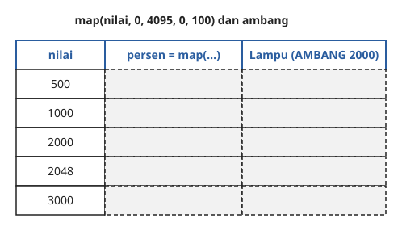

**Ingat dulu:** Tanpa melihat catatan: (1) Berapa kali badan `for (int i = 0; i < 5; i++)` dijalankan, dan berapa nilai `i` terakhir di dalam badan? (2) Satu byte dapat menyimpan berapa nilai berbeda? (3) Mengapa perulangan `while` dapat membuat program tidak pernah berhenti?

1. ______
2. ______
3. ______



`[Gambar: tabel lima baris nilai analogRead (500, 1000, 2000, 2048, 3000) dengan kolom persen (hasil map dari 0..4095 ke 0..100, aturan bilangan bulat) dan kolom keadaan lampu dengan AMBANG 2000 (lampu menyala bila nilai < AMBANG). Dua kolom itu kosong untuk diisi.]`

**Prediksi:** Program menyalakan LED bila `nilai < AMBANG` dengan `AMBANG = 2000`. Bila `nilai` 500, LED ______ ; bila 3000, ______ ; bila tepat 2000, ______ . Program ini menyalakan LED saat gelap atau saat terang? ______

**Lengkapi:** Potensiometer mengatur lama kedipan LED, 100 ms sampai 1000 ms.

```arduino setengah-jadi
void loop() {
  int nilai = analogRead(PIN_POT);
  long jeda_ms = map(nilai, 0, ____, 100, 1000);
  digitalWrite(PIN_LED, HIGH);
  delay(jeda_ms);
  digitalWrite(PIN_LED, ____);
  delay(____);
}
```

**Susun:** Susun baris menjadi `loop()` program ambang cahaya. Urutan huruf: ______

- A. `  int nilai = analogRead(PIN_SENSOR);`
- B. `void loop() {`
- C. `  if (nilai < AMBANG) {`
- D. `}`
- E. `    digitalWrite(PIN_LED, HIGH);`
- F. `  } else {`
- G. `    digitalWrite(PIN_LED, LOW);`
- H. `  }`

**Latihan:**

1. `AI: boleh` Tulis pseudocode, lalu programnya: LED menyala bila nilai potensiometer di bawah 1000 atau di atas 3000. ______
2. `AI: tanpa AI` Pilih `int`, `float`, `bool`, atau `uint8_t` untuk: (a) jumlah putaran, (b) suhu 27,5, (c) tombol sedang ditekan atau tidak, (d) satu byte hasil baca. Berapa hasil `float rata = (7 + 2) / 2;`? ______
3. ADC 12 bit memberi berapa nilai berbeda, dan berapa nilai terbesarnya? Bandingkan dengan satu byte. ______
4. Tulis kondisi: lampu menyala bila gelap (`nilai < AMBANG`) dan tombol ditekan (`INPUT_PULLUP`, ditekan terbaca `LOW`). ______

**Cek diri:**

- [ ] Saya dapat menghitung hasil pembagian bilangan bulat dan `map`.
- [ ] Saya dapat menentukan ambang dari pengukuran, bukan dari tebakan.

**Catatan cetak (untuk guru, tidak dicetak):** satu halaman A4. Kunci ada di modul `c-x1-m11` bagian "Kunci dan petunjuk". Lembar tidak memuat kolom identitas.
