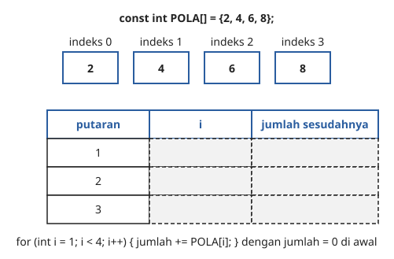

**Ingat dulu:** Tanpa melihat catatan: (1) Berapa hasil `7 / 2` dan `7.0 / 2` dalam C++, dan mengapa berbeda? (2) Dengan `INPUT_PULLUP`, nilai apa yang dibaca `digitalRead` saat tombol ditekan? (3) Apa beda memori (RAM) dan penyimpanan?

1. ______
2. ______
3. ______



`[Gambar: larik POLA berisi 2, 4, 6, 8 dengan indeks 0 sampai 3 di atas tiap kotak. Di bawahnya tabel tiga putaran for (int i = 1; i < 4; i++) { jumlah += POLA[i]; } dengan jumlah awal 0. Kolom i dan kolom jumlah sesudahnya kosong untuk diisi.]`

**Prediksi:** Program menampilkan `POLA[] = {1, 0, 0, 1}` dengan `PANJANG = 4` dan `delay(100)` tiap langkah. (1) Berapa langkah LED menyala dalam satu putaran `loop()`? ______ (2) Berapa milidetik satu putaran? ______ (3) Berapa nilai `POLA[2]`? ______ (4) Apa yang terjadi bila `PANJANG` diganti 5? ______

**Lengkapi:** Fungsi `nyalaSebentar` menyalakan LED sesuai durasi parameternya; `dibawahAmbang` mengembalikan 1 bila nilai di bawah ambang.

```arduino setengah-jadi
void nyalaSebentar(int durasi_ms) {
  digitalWrite(PIN_LED, ____);
  delay(____);
  digitalWrite(PIN_LED, LOW);
}

int dibawahAmbang(int nilai, int ambang) {
  if (nilai < ambang) {
    return ____;
  }
  return 0;
}
```

**Susun:** Susun baris menjadi fungsi `tampilkanPola()`. Urutan huruf: ______

- A. `}`
- B. `  for (int i = 0; i < PANJANG; i++) {`
- C. `void tampilkanPola() {`
- D. `    digitalWrite(PIN_LED, POLA[i]);`
- E. `  }`
- F. `    delay(100);`

**Latihan:**

1. `AI: boleh` Tulis pseudocode, lalu programnya: fungsi `kedip(pin, kali, jeda_ms)` yang dipakai di `loop()` untuk berkedip tiga kali cepat lalu jeda 1 detik. ______
2. `AI: tanpa AI` Larik `POLA` berisi 5 elemen dan `PANJANG_POLA` bernilai 5, tetapi perulangannya `for (int i = 0; i <= PANJANG_POLA; i++)`. Apa yang salah dan bagaimana memperbaikinya? ______
3. Tulis fungsi `int persen(int nilai)` yang mengembalikan `map(nilai, 0, 4095, 0, 100)`. Berapa `persen(2048)`? ______
4. Larik `POLA` berisi 1, 0, 1, 1, 0 dibaca sebagai bilangan biner lima bit dari kiri ke kanan. Berapa nilai desimalnya? ______

**Cek diri:**

- [ ] Saya dapat menjelaskan beda `void` dan `int` pada fungsi.
- [ ] Saya dapat menemukan galat indeks di luar larik.

**Catatan cetak (untuk guru, tidak dicetak):** satu halaman A4. Kunci ada di modul `c-x1-m12` bagian "Kunci dan petunjuk". Lembar tidak memuat kolom identitas.
