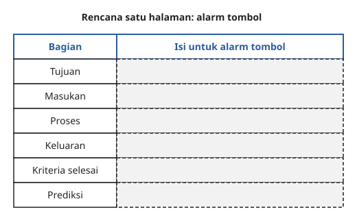

**Ingat dulu:** Tanpa melihat catatan: (1) Apa beda fungsi `void` dan fungsi `int`? (2) Mengapa mencetak nilai variabel ke monitor serial membantu mencari galat? (3) Mengapa data pribadi sebaiknya dibagikan seperlunya saja?

1. ______
2. ______
3. ______



`[Gambar: tabel dua kolom, Bagian dan Isi untuk alarm tombol. Enam baris: Tujuan, Masukan, Proses, Keluaran, Kriteria selesai, Prediksi. Semua isi kosong. Alarm tombol: masukannya tombol (INPUT_PULLUP), keluarannya buzzer atau LED.]`

**Prediksi:** Pada program lampu malam dengan `AMBANG = 2000` dan `gelap(nilai)` bernilai `nilai < AMBANG`: nilai 3500 membuat LED ______ ; nilai 400 ______ ; nilai tepat 2000 ______ ; nilai 1999 ______ .

**Lengkapi:** Pseudocode lampu malam otomatis.

```text
ULANG TERUS:
  baca nilai ______
  BILA nilai ______ AMBANG:
    ______ LED
  JIKA TIDAK:
    ______ LED
  tunggu ______ ms
```

**Latihan:**

1. Isi tabel di gambar untuk alarm tombol: kapan alarm menyala, kapan padam, dan apa yang terjadi bila tombol ditekan lama. ______
2. Pada program lampu malam, ubah syarat agar lampu hanya menyala bila gelap **dan** tombol ditekan. Tulis kondisinya. ______
3. Sensor memberi nilai 2500 dan kamu memakai `map(nilai, 0, 4095, 0, 100)`. Berapa persen, dengan aturan bilangan bulat? ______
4. Satu putaran `loop()` memakai `delay(200)`. Berapa kali sensor dibaca dalam 10 detik, bila waktu baca diabaikan? ______

**Cek diri:**

- [ ] Saya dapat menjelaskan sistemku sebagai masukan, proses, dan keluaran.
- [ ] Saya menguji nilai biasa dan nilai batas.
- [ ] Saya dapat menyebut satu hal yang berbeda antara prediksi dan hasil.

**Catatan cetak (untuk guru, tidak dicetak):** satu halaman A4. Kunci ada di modul `c-x1-m13` bagian "Kunci dan petunjuk". Lembar tidak memuat kolom identitas.
