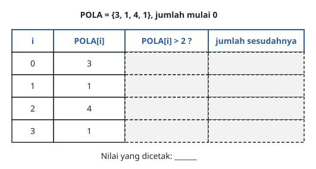

**Ingat dulu:** Tanpa melihat catatan: (1) Sebutkan tiga bagian siklus Input-Proses-Output, lalu satu sensor dan satu aktuator pada papan. (2) Ubah bilangan biner 1101 menjadi desimal dan heksadesimal. (3) Sebutkan dua ciri kata sandi yang kuat.

1. ______
2. ______
3. ______



`[Gambar: tabel empat baris untuk larik POLA = {3, 1, 4, 1} dengan indeks i 0 sampai 3. Kolom "POLA[i] > 2 ?" dan "jumlah sesudahnya" kosong; jumlah mulai 0. Di bawah tabel ada isian "Nilai yang dicetak".]`

**Latihan:** (kerjakan sendiri, `AI: tanpa AI`)

1. Tulis pseudocode lalu programnya: LED menyala selama tombol ditekan, dan sesudah tombol dilepas LED masih menyala 2 detik sebelum padam. Pakai `INPUT_PULLUP` dan konstanta bernama untuk pin dan jeda. ______
2. Telusuri larik `POLA` pada gambar dengan `if (POLA[i] > 2) { jumlah += POLA[i]; }` lalu `Serial.println(jumlah);`. Apa yang tercetak? Berapa kali kondisi benar? ______
3. Sensor memberi nilai 1024 dari rentang 0 sampai 4095. Berapa `map(1024, 0, 4095, 0, 100)`? Berapa nilai `x` setelah `float x = 9 / 2;` dan mengapa? ______
4. Potongan ini sengaja salah. Tulis dua galat, akibatnya, dan perbaikannya. ______

```text setengah-jadi
const int POLA[] = {1, 0, 1};
const int PANJANG = 3;
for (int i = 0; i <= PANJANG; i++) {
  if (digitalRead(PIN_TOMBOL) = LOW) {
    digitalWrite(PIN_LED, POLA[i]);
  }
}
```

5. Tanpa papan: tulis daftar sambungan tombol dan LED (apa disambung ke apa) dan empat langkah keselamatan sebelum mengubah rangkaian. ______

**Cek diri:**

- [ ] Saya dapat menemukan galat `=` tertukar `==` dan galat satu-lebih.
- [ ] Saya dapat menghitung `map` dan pembagian bilangan bulat.
- [ ] Saya tahu langkah keselamatan sebelum mengubah rangkaian.

**Catatan cetak (untuk guru, tidak dicetak):** satu halaman A4. Kunci ada di modul `c-x1-m14` bagian "Kunci dan petunjuk". Lembar tidak memuat kolom identitas.
