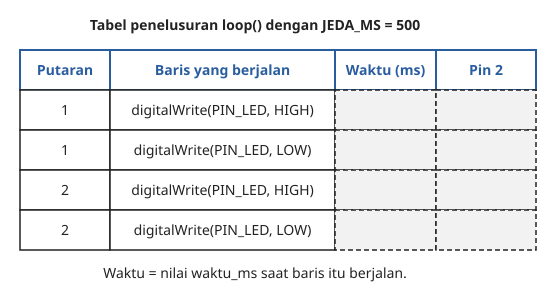

**Ingat dulu:** Tanpa melihat catatan: (1) Sebutkan tiga bagian siklus Input-Proses-Output dan satu contoh perangkat. (2) Berapa nilai berbeda yang dapat disimpan satu byte? (3) Tulis 10101010 (biner) dalam heksadesimal.

1. ______
2. ______
3. ______



`[Gambar: tabel empat baris penelusuran loop(): putaran 1 dan 2, masing-masing baris digitalWrite HIGH lalu digitalWrite LOW pada PIN_LED, dengan JEDA_MS = 500. Kolom Waktu (ms) dan kolom Pin 2 kosong. Isi waktu_ms saat tiap baris berjalan dan keadaan pin.]`

**Prediksi:** Bagi program yang menyalakan LED 500 ms lalu memadamkannya 500 ms secara berulang: (1) berapa detik LED menyala tiap kali? ______ (2) berapa kali LED menyala dalam 10 detik? ______ (3) bagian mana dijalankan sekali, bagian mana diulang terus? ______ (4) apa yang berubah bila `JEDA_MS` menjadi 250? ______

**Lengkapi:** LED berkedip dua kali cepat (masing-masing 100 ms) lalu jeda 1 detik.

```arduino setengah-jadi
const int PIN_LED = 2;
const int KEDIP_MS = 100;
const int JEDA_PANJANG_MS = ____;

void setup() {
  pinMode(PIN_LED, OUTPUT);
}

void loop() {
  digitalWrite(PIN_LED, HIGH);
  delay(KEDIP_MS);
  digitalWrite(PIN_LED, ____);
  delay(KEDIP_MS);
  // kedipan kedua: tulis sendiri empat baris
  ____
  delay(JEDA_PANJANG_MS);
}
```

**Susun:** Susun baris menjadi program yang menyalakan lalu memadamkan LED dengan jeda sama. Urutan huruf: ______

- A. `  delay(JEDA_MS);`
- B. `void loop() {`
- C. `  digitalWrite(PIN_LED, LOW);`
- D. `}`
- E. `void setup() {`
- F. `  pinMode(PIN_LED, OUTPUT);`
- G. `  digitalWrite(PIN_LED, HIGH);`
- H. `  delay(JEDA_MS);`
- I. `}`

**Latihan:**

1. `AI: boleh` Tulis pseudocode untuk: LED menyala 200 ms, padam 800 ms, diulang terus. Lalu tulis programnya dengan dua konstanta, `NYALA_MS` dan `PADAM_MS`. ______
2. `AI: tanpa AI` Untuk nomor 1, berapa ms satu putaran? Berapa kali LED menyala dalam 10 detik? ______
3. `AI: tanpa AI` Gambar diagram I-P-O untuk lampu lalu lintas mini dengan tombol penyeberang: masukan, proses, keluaran. ______
4. Selama `delay(500)` berjalan, apakah papan dapat membaca tombol? Mengapa? ______

**Cek diri:**

- [ ] Saya dapat menyebut tugas `setup()` dan `loop()`.
- [ ] Saya dapat menghitung periode dan jumlah kedipan dari nilai `delay`.
- [ ] Saya tahu langkah keselamatan sebelum mengubah rangkaian.

**Catatan cetak (untuk guru, tidak dicetak):** satu halaman A4. Kunci ada di modul `c-x1-m8` bagian "Kunci dan petunjuk". Lembar tidak memuat kolom identitas.
