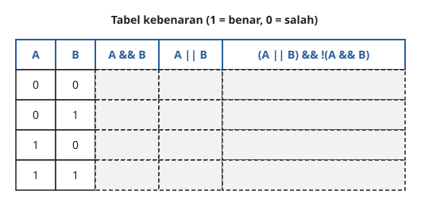

**Ingat dulu:** Tanpa melihat catatan: (1) Apa beda `setup()` dan `loop()`? (2) Dalam diagram I-P-O, apakah tombol itu masukan atau keluaran? Bagaimana dengan LED? (3) Satu bit dapat menyimpan nilai apa saja?

1. ______
2. ______
3. ______



`[Gambar: tabel kebenaran empat baris untuk kombinasi A dan B (0 0, 0 1, 1 0, 1 1) dengan tiga kolom hasil kosong: A && B, A || B, dan (A || B) && !(A && B). Isi tiap sel dengan 1 (benar) atau 0 (salah).]`

**Prediksi:** Tombol disambung ke pin 4 dan GND dengan `INPUT_PULLUP`; LED menyala bila `digitalRead(PIN_TOMBOL) == LOW`, selain itu padam. (1) Tombol tidak ditekan: LED ______ (2) Tombol ditekan: LED ______ (3) Mengapa pembandingnya `LOW`, bukan `HIGH`? ______ (4) Bila bagian `else` dihapus, apa yang terjadi setelah tombol dilepas? ______

**Lengkapi:** LED menyala bila tepat satu dari dua tombol ditekan.

```arduino setengah-jadi
void loop() {
  bool a_ditekan = (digitalRead(PIN_A) == ____);
  bool b_ditekan = (digitalRead(PIN_B) == LOW);
  if ((a_ditekan || b_ditekan) && ____(a_ditekan && b_ditekan)) {
    digitalWrite(PIN_LED, HIGH);
  } else {
    digitalWrite(PIN_LED, ____);
  }
}
```

**Susun:** Susun baris menjadi fungsi `loop()` program tombol-LED. Urutan huruf: ______

- A. `} else {`
- B. `  digitalWrite(PIN_LED, LOW);`
- C. `void loop() {`
- D. `  if (digitalRead(PIN_TOMBOL) == LOW) {`
- E. `}`
- F. `  digitalWrite(PIN_LED, HIGH);`
- G. `  }`

**Latihan:**

1. `AI: boleh` Tulis pseudocode, lalu programnya: LED menyala hanya bila tombol A dan tombol B ditekan bersamaan. ______
2. `AI: tanpa AI` Pada program tepat satu tombol, tombol A ditekan terus selama lima langkah dan tombol B hanya pada langkah 2 dan 3. Tulis keadaan LED pada langkah 0 sampai 4. ______
3. Dua tombol mewakili bilangan dua bit: A bit tinggi, B bit rendah, ditekan = 1. Tulis nilai desimal keempat kombinasi (A, B). ______
4. Gambar diagram I-P-O untuk bel pintu mini dan tulis kondisi agar bel berbunyi. ______

**Cek diri:**

- [ ] Saya dapat menjelaskan mengapa `INPUT_PULLUP` membuat tombol ditekan terbaca `LOW`.
- [ ] Saya dapat melengkapi tabel kebenaran untuk `&&`, `||`, dan `!`.

**Catatan cetak (untuk guru, tidak dicetak):** satu halaman A4. Kunci ada di modul `c-x1-m9` bagian "Kunci dan petunjuk". Lembar tidak memuat kolom identitas.
