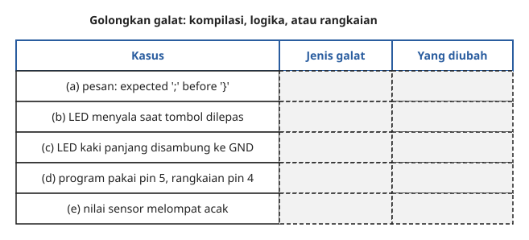

**Ingat dulu:** Tanpa melihat catatan: (1) Berapa indeks elemen pertama dan terakhir pada larik berisi 5 elemen? (2) Dengan `INPUT_PULLUP`, nilai apa yang dibaca `digitalRead` saat tombol ditekan? (3) Sebutkan tiga hal yang kamu lakukan sebelum mengubah rangkaian.

1. ______
2. ______
3. ______



`[Gambar: tabel lima kasus galat (a) sampai (e): pesan "expected ';' before '}'"; LED menyala saat tombol dilepas; LED kaki panjang disambung ke GND; program pakai pin 5 sedangkan rangkaian pin 4; nilai sensor melompat acak. Kolom "Jenis galat" (kompilasi, logika, atau rangkaian) dan kolom "Yang diubah" kosong untuk diisi.]`

**Prediksi:** Program kedip menulis ke `PIN_LED = 2`, tetapi LED dan resistornya disambung ke pin 4. (1) Apa yang tampak pada LED? ______ (2) Galat kode atau galat rangkaian? ______ (3) Sebutkan dua cara memperbaikinya. ______

**Lengkapi:** Program mencetak nilai mentah tombol tiap 200 ms.

```arduino setengah-jadi
const int PIN_TOMBOL = 15;

void setup() {
  Serial.begin(115200);
  pinMode(PIN_TOMBOL, ____);
}

void loop() {
  int nilai = digitalRead(____);
  Serial.println(____);
  delay(200);
}
```

**Susun:** Susun baris menjadi `loop()` yang mencetak nilai tombol tiap 200 ms. Urutan huruf: ______

- A. `}`
- B. `  delay(200);`
- C. `void loop() {`
- D. `  Serial.println(nilai);`
- E. `  int nilai = digitalRead(PIN_TOMBOL);`

**Latihan:**

1. `AI: boleh` LED tidak menyala. Tulis pseudocode langkah penelusuran berurutan, satu uji per langkah, termasuk kapan kamu berhenti dan memanggil guru. ______
2. `AI: tanpa AI` Isi tabel pada gambar: jenis galat tiap kasus dan apa yang diubah. ______
3. `AI: tanpa AI` Tulis daftar galat umummu dalam dua kolom, galat kode dan galat kabel, masing-masing minimal empat baris dengan gejala, penyebab, dan cara memeriksa. ______
4. Program menulis `int persen = 3000 / 4095 * 100;` dan mencetak 0. Jelaskan, lalu tulis dua cara menghitung yang benar. ______

**Cek diri:**

- [ ] Saya dapat membedakan galat kompilasi, logika, dan rangkaian dari gejalanya.
- [ ] Saya dapat menyebut satu uji pemisah galat kode dari galat rangkaian.
- [ ] Saya mengubah satu hal pada satu waktu dan mencatat hasilnya.

**Catatan cetak (untuk guru, tidak dicetak):** satu halaman A4. Kunci ada di modul `c-x2-m1` bagian "Kunci dan petunjuk". Lembar tidak memuat kolom identitas.
