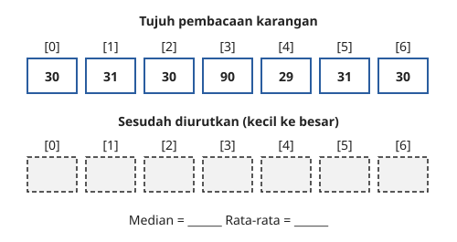

**Ingat dulu:** Tanpa melihat catatan: (1) Dari antrian berisi 5, 8, 3 (masuk berurutan), nilai mana yang keluar lebih dulu, dan nilai mana yang keluar lebih dulu dari tumpukan berisi urutan sama? (2) Mengapa sensor perlu jeda antar pembacaan, dan dari mana kamu tahu lamanya?

1. ______
2. ______



`[Gambar: larik tujuh pembacaan 30, 31, 30, 90, 29, 31, 30 dengan indeks 0 sampai 6, dan di bawahnya tujuh kotak kosong untuk menulis larik setelah diurutkan dari kecil ke besar. Di bawahnya ada isian "Median" dan "Rata-rata".]`

**Prediksi:** Pada tujuh pembacaan di gambar, nilai keberapa yang di tengah setelah diurutkan? ______ Berapa median dan berapa rata-rata (satu angka di belakang koma)? ______ Mana yang lebih mewakili keadaan sebenarnya, dan mengapa? ______

**Lengkapi:** Pengurutan sisip.

```arduino setengah-jadi
void urutkan(int a[], int n) {
  for (int i = 1; i < n; i++) {
    int nilai = a[i];
    int j = i - 1;
    while (j >= 0 && a[j] > ____) {
      a[j + 1] = a[____];
      j--;
    }
    a[____] = nilai;
  }
}
```

**Susun:** Susun baris menjadi fungsi `median` yang tidak merusak larik asli. Urutan huruf: ______

- A. `}`
- B. `  urutkan(salinan, n);`
- C. `  return salinan[n / 2];`
- D. `int median(const int data[], int n) {`
- E. `  for (int i = 0; i < n; i++) { salinan[i] = data[i]; }`
- F. `  int salinan[N];`

**Latihan:**

1. `AI: tanpa AI` Tujuh pembacaan: 12, 15, 11, 40, 13, 14, 12. Berapa median dan berapa rata-rata (satu angka di belakang koma)? ______
2. `AI: tanpa AI` Seorang murid memanggil `urutkan(data, n)` langsung pada larik asli di dalam `median`. Apa yang rusak pada program yang juga menggambar grafik dari larik itu? ______
3. `AI: boleh` Tulis pseudocode lalu program yang memberi median dari tujuh pembacaan karangan dan menandai pembacaan yang selisihnya dari median lebih dari 10. ______
4. Pada data 4, 5, 100, 5, 4, mana yang lebih mewakili, rata-rata atau median? Berapa masing-masing? ______

**Cek diri:**

- [ ] Saya dapat menelusuri pengurutan sisip pada larik kecil.
- [ ] Saya dapat menjelaskan kapan median lebih baik daripada rata-rata.

**Catatan cetak (untuk guru, tidak dicetak):** satu halaman A4. Kunci ada di modul `c-x2-m10` bagian "Kunci dan petunjuk". Lembar tidak memuat kolom identitas.
