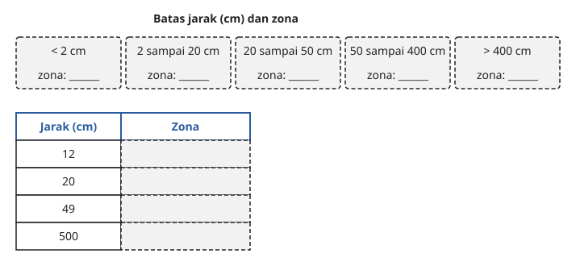

**Ingat dulu:** Tanpa melihat catatan: (1) Pada data 4, 5, 100, 5, 4, mana yang lebih mewakili, rata-rata atau median? Berapa masing-masing? (2) Sebut dua cara memeriksa bahwa sensormu membaca dengan benar tanpa bergantung pada program. (3) Berapa hasil `7 / 2` dan `7.0 / 2` dalam C++, dan mengapa berbeda?

1. ______
2. ______
3. ______



`[Gambar: lima rentang jarak (kurang dari 2, 2 sampai 20, 20 sampai 50, 50 sampai 400, lebih dari 400 sentimeter) dengan isian zona kosong, dan tabel jarak 12, 20, 49, dan 500 cm dengan kolom zona kosong. Zona yang tersedia: AMAN, WASPADA, BAHAYA, TIDAK_VALID.]`

**Prediksi:** Batas bahaya 20 cm, batas waspada 50 cm, rentang valid 2 sampai 400 cm. Isi zona tiap jarak di gambar. Waktu gema 1166 mikrodetik dengan jarak = waktu x 0,0343 / 2: jaraknya ______ cm (satu angka di belakang koma), zona ______ .

**Lengkapi:** Dua fungsi pengubah waktu gema dan penentu zona.

```arduino setengah-jadi
float cmDariMikrodetik(unsigned long mikrodetik) {
  return mikrodetik * CM_PER_US / ____;
}

Zona zonaDari(float cm) {
  if (cm < JARAK_MIN_CM || cm > ____) {
    return TIDAK_VALID;
  }
  if (cm < ____) {
    return BAHAYA;
  }
  if (cm < BATAS_WASPADA_CM) {
    return WASPADA;
  }
  return AMAN;
}
```

**Susun:** Susun baris menjadi `zonaDari` yang benar; urutan pemeriksaan penting. Urutan huruf: ______

- A. `  return AMAN;`
- B. `Zona zonaDari(float cm) {`
- C. `  if (cm < BATAS_WASPADA_CM) { return WASPADA; }`
- D. `}`
- E. `  if (cm < BATAS_BAHAYA_CM) { return BAHAYA; }`
- F. `  if (cm < JARAK_MIN_CM || cm > JARAK_MAKS_CM) { return TIDAK_VALID; }`

**Latihan:**

1. `AI: tanpa AI` Berapa jarak (satu angka di belakang koma) dan zona untuk waktu gema 3500 mikrodetik dan 700 mikrodetik? ______
2. `AI: tanpa AI` Program memakai `cmDariMikrodetik(waktu)` tanpa memeriksa nilai kembalian `bacaMikrodetik`, dan `waktu` bernilai 0 saat tidak ada benda. Apa yang dilakukan alarm, dan mengapa itu salah? ______
3. `AI: boleh` Tulis pseudocode lalu program alarm parkir mini: buzzer berbunyi di zona `BAHAYA`, LED menyala di zona `WASPADA` dan `BAHAYA`, tidak ada yang menyala di zona `TIDAK_VALID`. ______
4. Lima pembacaan jarak: 52, 53, 3, 52, 51 (cm). Zona apa bila keputusan memakai rata-rata, dan zona apa bila memakai median? ______

**Cek diri:**

- [ ] Saya dapat menjelaskan mengapa jarak dibagi dua.
- [ ] Saya menentukan batas keputusan dari pengukuran dengan penggaris.

**Catatan cetak (untuk guru, tidak dicetak):** satu halaman A4. Kunci ada di modul `c-x2-m11` bagian "Kunci dan petunjuk". Lembar tidak memuat kolom identitas.
