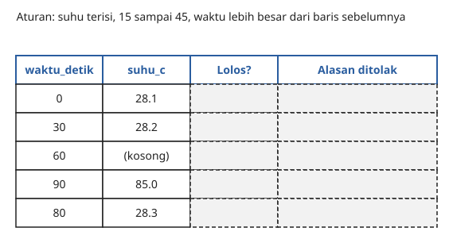

**Ingat dulu:** Tanpa melihat catatan: (1) Mengapa nilai 0 atau sangat besar dari sensor jarak diperlakukan sebagai "tidak valid"? (2) Apa yang harus dilakukan antrian penuh ketika data baru datang, dan apa harga tiap pilihannya?

1. ______
2. ______



`[Gambar: tabel lima baris berkas CSV (waktu_detik, suhu_c): 0 dan 28.1; 30 dan 28.2; 60 dan kosong; 90 dan 85.0; 80 dan 28.3. Aturan di atas tabel: suhu terisi, antara 15 dan 45, waktu lebih besar dari baris sebelumnya. Kolom "Lolos?" dan "Alasan ditolak" kosong.]`

**Prediksi:** Baris mana saja yang ditolak dan karena aturan yang mana? ______ Berapa baris yang lolos? ______ Mengapa alasan penolakan dicatat, bukan baris dihapus diam-diam? ______

**Lengkapi:** Satu baris berisi waktu dan suhu, dipisah koma.

```arduino setengah-jadi
void cetakBaris(unsigned long detik, float suhu) {
  Serial.print(____);
  Serial.print(____);
  Serial.println(____, 1);
}
```

**Susun:** Susun baris menjadi `loop()` yang mencatat satu baris tiap `SELANG_MS`. Urutan huruf: ______

- A. `    cetakBaris(millis() / 1000, suhuDariMentah(analogRead(PIN_SENSOR)));`
- B. `}`
- C. `void loop() {`
- D. `    mulai += SELANG_MS;`
- E. `  }`
- F. `  if (millis() - mulai >= SELANG_MS) {`

**Latihan:**

1. `AI: tanpa AI` Selama 10 menit dengan selang 30 detik, berapa baris data (tanpa kepala) bila baris pertama dicatat pada detik 0? Berapa bila baris pertama pada detik 30? ______
2. `AI: tanpa AI` Pada program pemeriksa, apa yang tercetak untuk rata-rata bila semua baris ditolak, dan apa perbaikannya? ______
3. `AI: boleh` Tulis pseudocode lalu program pencatat yang mencetak kepala sekali, lalu satu baris `waktu_detik,suhu_c` tiap 30 detik tanpa `delay()`. ______
4. Sebut tiga hal yang harus ada di kepala berkas data agar orang lain dapat membacanya. ______

**Cek diri:**

- [ ] Saya menulis kepala berkas dengan satuan dan selang waktu.
- [ ] Saya memeriksa berkas dengan aturan tertulis dan mencatat alasan penolakan.

**Catatan cetak (untuk guru, tidak dicetak):** satu halaman A4. Kunci ada di modul `c-x2-m12` bagian "Kunci dan petunjuk". Lembar tidak memuat kolom identitas.
