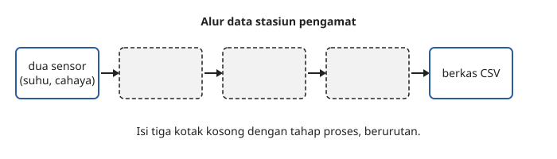

**Ingat dulu:** Tanpa melihat catatan: (1) Sebut tiga hal yang harus ada di kepala berkas data agar orang lain dapat membacanya. (2) Mengapa median tujuh pembacaan membuang lonjakan tunggal, sedangkan rata-rata tidak? (3) Mengapa batas bawah dan atas potensiometer perlu diukur, bukan diasumsikan 0 dan 4095?

1. ______
2. ______
3. ______



`[Gambar: diagram lima kotak berurutan dengan panah: "dua sensor (suhu, cahaya)", tiga kotak kosong untuk tahap proses, lalu "berkas CSV". Isi tiga kotak kosong dengan tahap proses stasiun pengamat, berurutan.]`

**Prediksi:** Lima pembacaan cahaya: 400, 380, 420, 10, 390 (nilai kecil = gelap; `AMBANG_GELAP = 800`). Berapa median dan rata-ratanya? ______ Kategori apa yang dihasilkan bila memakai median? ______

**Lengkapi:** Pseudocode stasiun suhu dan cahaya.

```text
ULANG TERUS:
  BILA sudah ______ ms sejak pembacaan terakhir:
    simpan pembacaan ______ dan ______
    BILA sudah ______ pembacaan:
      cetak waktu, suhu dari ______, cahaya median, kategori
      mulai lagi dari ______ pembacaan
```

**Latihan:**

1. Rancang rencana satu halaman untuk stasiunmu sendiri (enam bagian: tujuan, diagram I-P-O, pseudocode, kriteria selesai, daftar uji, prediksi hasil). ______
2. Tulis satu kasus uji untuk `median` yang semua nilainya sama, dan hasil yang kamu harapkan. ______
3. Tulis satu baris CSV untuk detik 90, suhu 28,1, cahaya mentah 2900, dan kategori `TERANG` sesuai kepala `waktu_detik,suhu_c,cahaya,kategori`. ______
4. Mengapa penyaring dipasang sebelum keputusan, bukan sesudahnya? ______

**Cek diri:**

- [ ] Saya menulis kriteria selesai yang dapat diuji sebelum memrogram.
- [ ] Saya menguji nilai biasa, lonjakan, dan nilai batas.
- [ ] Saya dapat menyebut satu hal yang berbeda antara prediksi dan hasil.

**Catatan cetak (untuk guru, tidak dicetak):** satu halaman A4. Kunci ada di modul `c-x2-m13` bagian "Kunci dan petunjuk". Lembar tidak memuat kolom identitas.
