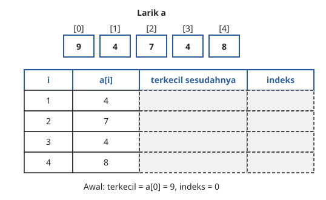

**Ingat dulu:** Tanpa melihat catatan: (1) Sebut dua aturan keselamatan untuk bagian yang bergerak. (2) Berapa rata-rata bergerak tiga pembacaan terakhir dari 10, 12, 20? (3) Dari antrian berisi 5, 8, 3 (masuk berurutan), nilai mana yang keluar lebih dulu, dan nilai mana yang keluar lebih dulu dari tumpukan berisi urutan sama?

1. ______
2. ______
3. ______



`[Gambar: larik a berisi 9, 4, 7, 4, 8 dengan indeks 0 sampai 4, dan tabel empat baris untuk i dari 1 sampai 4 (a[i] terisi). Kolom "terkecil sesudahnya" dan "indeks" kosong; awalnya terkecil = 9 dan indeks = 0.]`

**Latihan:** (kerjakan sendiri, `AI: tanpa AI`)

1. Telusuri program ini dengan tabel pada gambar. Apa yang tercetak? Mengapa nilai 4 yang kedua tidak mengganti hasilnya? ______

```cpp
#include <iostream>

int main() {
  const int a[5] = {9, 4, 7, 4, 8};
  int terkecil = a[0];
  int indeks = 0;
  for (int i = 1; i < 5; i++) {
    if (a[i] < terkecil) {
      terkecil = a[i];
      indeks = i;
    }
  }
  std::cout << terkecil << " di indeks " << indeks << "\n";
}
```

2. Waktu gema 1750 mikrodetik dengan 0,0343 cm per mikrodetik: berapa jaraknya (satu angka di belakang koma), dan zona apa dengan batas bahaya 20 cm dan batas waspada 50 cm? Berapa median lima pembacaan 12, 15, 11, 40, 13? ______
3. Tulis pseudocode lalu program `masuk` dan `keluar` untuk antrian berkapasitas 3 dari larik bilangan bulat: `masuk` menolak data baru bila penuh, `keluar` mengambil yang tertua lalu menggeser sisanya. ______
4. Potongan ini sengaja salah. Tulis dua galat, akibatnya, dan perbaikannya. ______

```text setengah-jadi
int median(int data[], int n) {
  urutkan(data, n);
  return data[n / 2 + 1];
}
```

5. Tanpa papan: tulis kepala berkas data tiga kolom (waktu, suhu, cahaya) dengan satuan dan selang waktu, lalu tiga baris karangan. ______

**Cek diri:**

- [ ] Saya dapat menghitung rata-rata bergerak dan median.
- [ ] Saya dapat menelusuri pencarian linear dan menjelaskan hasilnya.
- [ ] Saya dapat menulis kepala berkas data dengan satuan dan selang waktu.

**Catatan cetak (untuk guru, tidak dicetak):** satu halaman A4. Kunci ada di modul `c-x2-m14` bagian "Kunci dan petunjuk". Lembar tidak memuat kolom identitas.
